# Database architecture

Audit baseline: 2026-11-20, from `prisma/schema.prisma`, `prisma/postgres/schema.prisma`, both migration folders, `lib/db.ts`, `lib/bulk.ts` and `scripts/db.mjs`. Application-level behaviour lives in [../CURRENT_STATE.md](../CURRENT_STATE.md); runtime flow in [SYSTEM_ARCHITECTURE.md](SYSTEM_ARCHITECTURE.md).

## 1. Technology and schema management

- **ORM:** Prisma 6.19.3 (`@prisma/client`). All access goes through one client (`lib/db.ts: prisma`), plus typed raw SQL for bulk writes (`lib/bulk.ts`).
- **Providers:** SQLite (local development and automated e2e tests) and PostgreSQL (production on Neon; tests via PGlite). Chosen by the `DATABASE_URL` prefix: `file:` is SQLite; `postgres://`/`postgresql://` is PostgreSQL (`scripts/db.mjs`, `lib/db.ts`).
- **Single source of truth:** `prisma/schema.prisma` (SQLite). `prisma/postgres/schema.prisma` is **generated** from it by `node scripts/db.mjs sync` (only the `datasource` block differs; header says "GENERATED ... edit that file, not this one"). Never edit the PostgreSQL schema by hand.
- **Migrations are separate per provider and hand-maintained:**
  - SQLite `prisma/migrations/`: `20261011080316_init`, `20261028070000_multi_user`, `20261105090000_multi_certification`.
  - PostgreSQL `prisma/postgres/migrations/`: `20261028080000_init` (already includes the multi-user changes), `20261105090000_multi_certification`.
  - Any schema change must be added to **both** folders. Nothing verifies that the two histories produce equivalent databases except the test suite running on both providers.
- **Connections (PostgreSQL):** `DATABASE_URL` for queries (Neon: pooled host), `DIRECT_URL` for migrations (Neon: direct host); `DIRECT_URL` defaults to `DATABASE_URL` in `scripts/db.mjs`. An optional `&schema=NAME` selects a PostgreSQL schema (used for demo/test isolation); production uses `public`.
- **Generated client is provider-specific.** `npm run db:generate` generates for the provider in the current `DATABASE_URL`; the client in `node_modules` is for one provider at a time.
- **Types:** all enumerations are plain `String` columns with the allowed values in comments only; all JSON is stored as `String` containing JSON. **No database enum, `CHECK` or JSON type is used**, so the database does not reject invalid status values; validation is in application code (Zod and domain functions).
- **Raw SQL and the Neon pooler:** the pooler does not preserve `search_path`, so raw statements in `lib/bulk.ts` are qualified with the schema name (derived from the URL, falling back to `_engineConfig.overrideDatasources`, an internal Prisma field; see risks in section 9).
- **Data tools:** `scripts/copy-sqlite-to-postgres.ts` (one-way, refuses to write into a database that has rows, copies in one transaction, resets sequences, compares counts; Node 22.13+), `scripts/backup-db.ts`/`lib/backup.ts` (SQLite file copy; PostgreSQL via `pg_dump`), `scripts/import-db.ts` (PMLE bank into a draft), `scripts/claim-local-progress.ts` (assign pre-multi-user progress to a user).

## 2. Model overview (29 models)

| Domain | Models |
|---|---|
| Catalogue | `Certification`, `ContentVersion` |
| Ingestion | `UploadedFile`, `IngestionJob`, `ImportRun`, `ImportIssue`, `DuplicateCandidate` |
| Question content (per version) | `QuestionSource`, `SourceOccurrence`, `CanonicalQuestion`, `AnswerOption`, `AnswerClaim`, `Explanation` |
| Blueprint (per version) | `ExamDomain`, `ExamObjective`, `QuestionObjectiveMapping`, `TheoryConcept`, `QuestionTopic` |
| Identity | `User`, `AuthSession` |
| Learner activity | `QuestionAttempt`, `QuestionFlag`, `QuestionNote`, `TheoryProgress`, `PracticeSession`, `SessionQuestion`, `StudyTaskCompletion`, `Setting` |
| Audit | `AuditEvent` |

```mermaid
erDiagram
  Certification ||--o{ ContentVersion : "versions"
  Certification |o--o| ContentVersion : "currentVersion (SetNull)"
  ContentVersion ||--o{ CanonicalQuestion : "cascade"
  ContentVersion ||--o{ QuestionSource : "cascade"
  ContentVersion ||--o{ SourceOccurrence : "cascade"
  QuestionSource ||--o{ SourceOccurrence : "restrict"
  CanonicalQuestion |o--o{ SourceOccurrence : "canonicalId (SetNull)"
  CanonicalQuestion ||--o{ AnswerOption : "cascade"
  CanonicalQuestion ||--o{ AnswerClaim : "cascade"
  CanonicalQuestion ||--o{ Explanation : "cascade"
  ContentVersion ||--o{ ExamDomain : "cascade"
  ExamDomain ||--o{ ExamObjective : "cascade"
  CanonicalQuestion ||--o{ QuestionObjectiveMapping : "cascade"
  ExamObjective ||--o{ QuestionObjectiveMapping : "cascade"
  ContentVersion ||--o{ TheoryConcept : "cascade"
  CanonicalQuestion ||--o{ QuestionTopic : "cascade"
  TheoryConcept ||--o{ QuestionTopic : "cascade"
  Certification ||--o{ IngestionJob : ""
  ContentVersion |o--o{ IngestionJob : "SetNull"
  UploadedFile |o--o{ IngestionJob : ""
  UploadedFile |o--o{ QuestionSource : ""
  User ||--o{ AuthSession : "cascade"
  User ||--o{ QuestionAttempt : "cascade"
  User ||--o{ QuestionFlag : "cascade"
  User ||--o{ QuestionNote : "cascade"
  User ||--o{ TheoryProgress : "cascade"
  User ||--o{ PracticeSession : "cascade"
  User ||--o{ StudyTaskCompletion : "cascade"
  User ||--o{ Setting : "cascade"
  CanonicalQuestion ||--o{ QuestionAttempt : "restrict"
  CanonicalQuestion ||--o{ QuestionFlag : "restrict"
  CanonicalQuestion ||--o{ QuestionNote : "restrict"
  CanonicalQuestion ||--o{ SessionQuestion : "restrict"
  PracticeSession ||--o{ SessionQuestion : "cascade"
  PracticeSession |o--o{ QuestionAttempt : "SetNull"
  ContentVersion ||--o{ PracticeSession : "restrict"
  ContentVersion ||--o{ StudyTaskCompletion : "restrict"
  TheoryConcept ||--o{ TheoryProgress : "restrict"
```

Edge labels show the delete rule on the child foreign key (cascade, restrict, SetNull). They were read from the PostgreSQL migrations (`ON DELETE ...`), not only the schema. Edges without a label use the rules listed in section 7.

## 3. Models, fields, keys and constraints

Types: `String` unless stated. `id` columns marked `cuid` are generated by Prisma (`@default(cuid())`), `auto` are autoincrement integers.

### 3.1 Catalogue

**`Certification`**: PK `id` (cuid). `slug` UNIQUE (URL segment, validated by `lib/cert-rules.ts`), `code`, `name`, `description` (""), `provider` (""), `status` (`active`|`archived`), `currentVersionId?` UNIQUE FK to `ContentVersion` (the published version; relation `CurrentVersion`), `createdBy?` (email), `createdAt`, `updatedAt`. Back-relations: `versions`, `jobs`, `files`.

**`ContentVersion`**: PK `id` (cuid). `certificationId` FK (restrict). `label` (e.g. "2026"), `status` (`draft`|`review`|`published`|`archived`, default `draft`), `basedOnId?` (plain string, not an FK: version copied from), `guideTitle?`, `sources` (JSON summary, frozen at publish), `fingerprint?` (SHA-256 of canonical content, set at submit-for-review, re-checked at publish), `questionCount`, `objectiveCount`, `notes?`, `createdBy/submittedBy/publishedBy?` (emails), `submittedAt/publishedAt/archivedAt?`, `createdAt`, `updatedAt`. **UNIQUE `(certificationId, label)`**; INDEX `(certificationId, status)`.

### 3.2 Ingestion

**`UploadedFile`**: PK `id` (cuid). `certificationId` FK, `purpose` (`questions`|`guide`; `guide` is never written by current code), `fileName`, `mimeType`, `byteSize` (Int), `sha256`, `data` (**Bytes**, the file content), `uploadedBy`, `createdAt`. INDEX `(certificationId, sha256)`.

**`IngestionJob`**: PK `id` (cuid). `certificationId` FK; `versionId?` FK to `ContentVersion` with **`onDelete: SetNull`**; `kind` (`pdf`|`url`|`json`); `purpose` (default `questions`); `sourceKey` (the `QuestionSource.id` this job fills; not an FK), `sourceName`, `sourceUrl?`, `fileId?` FK `UploadedFile`; `status` (default `queued`); `attempts`, `maxAttempts` (3), `nextRunAt`, `leaseOwner?`, `leaseUntil?`; JSON strings `stages`, `warnings`, `result`; `errorCode?`, `error?`; counters `extractedCount`, `validCount`, `duplicateCount`, `lowConfidenceCount`; `createdBy`, `createdAt`, `updatedAt`, `startedAt?`, `finishedAt?`. INDEX `(status, nextRunAt)`, `(certificationId, createdAt)`.
- **Schema comment vs code:** the comment lists `queued | processing | review_required | published | failed`, but `lib/ingest/jobs.ts` also uses `pending` (added by the explicit Start-processing flow), `cancelled` and `removed`, and `published` is not produced there. The column is free text, so this works; the comment is out of date.

**`ImportRun`**: `id` (auto), `versionId` FK cascade, `startedAt`, `finishedAt?`, `status` ("running"), `summary` (JSON).

**`ImportIssue`**: `id` (auto), `versionId` FK cascade, `issueKey`, `lastRunId?` (plain Int), `sourceKey?`, `questionId?` FK `CanonicalQuestion` (SetNull), `kind`, `severity` (`info|warning|error`), `message`, `status` (`open|resolved|ignored`), `resolution?`, `active` (true), `updatedAt`. **UNIQUE `(versionId, issueKey)`**.

**`DuplicateCandidate`**: `id` (auto), `versionId` FK cascade, `pairKey`, `aKey`, `bKey`, `stage` (`exact|fuzzy|semantic`), `score`, `stemRatio`, `optionSim`, `cosine?` (Float), `numberMismatch` (JSON), `answersAgree`, `suggestedDecision`, `reason`, `status` (`auto_confirmed|auto_rejected|pending|approved|rejected`), `previousStatus?`, `decidedAt?`, `updatedAt`. **UNIQUE `(versionId, pairKey)`**. Admin decisions on `status` survive re-imports (`previousStatus`).

### 3.3 Question content (all scoped by `versionId`)

**`QuestionSource`**: **composite PK `(versionId, id)`**; `versionId` FK cascade; `id` ("pdf", "examprepper", or an ingestion key), `name`, `kind` (`pdf|website|json`), `url?`, `fileName?`, `fileId?` FK `UploadedFile`, `declaredCount?`, `extractedCount`, `retrievedAt?`.

**`SourceOccurrence`**: one question as seen in one source. `id` (auto); `versionId` FK cascade; `sourceKey` (e.g. `pdf:84`); `sourceId` with composite FK `(versionId, sourceId)` to `QuestionSource` (restrict); `canonicalId?` FK `CanonicalQuestion` (SetNull, relation `canonical`); `homeCanonicalId?` (plain Int); `sourceQnum`, `sourceRef?`, `page?`, `pageEnd?`, `url?`, `originUrl?`, `topicLabel?`; `stem`, `options` (JSON), `answerLabels` (JSON), `rawText?`, `rawJson?`, `explanation?`, `discussion` (JSON), `images` (JSON), `issues` (JSON), `extractionConfidence` (Float, 1), `extractionMethod` (default `pipeline`; values include `pdf_text|pdf_ocr|html|rendered_html|screenshot_ocr|json`), `excluded` (Boolean, reviewer exclusion), `contentHash`, `stemHash`, `legacyStatus`, `legacyHits`, `classification`, `claims` (JSON), `lastImportRunId?` (plain Int), `updatedAt`. **UNIQUE `(versionId, sourceKey)`**; INDEX `(canonicalId)`.

**`CanonicalQuestion`**: the learner-facing question. `id` (**auto Int, per-row, unique across all versions**); `versionId` FK cascade; `code` (e.g. `Q-0009`, "stable across versions for the same question" per the schema comment; it is a label, not a link); `stem`, `multiSelect`, `selectCount`; `primaryOccurrenceId?` and `mergedIntoId?` (plain Ints, no FK); verification fields `verification` (`verified|source_key|contested|conflict|unknown|user_verified`), `verificationNote?`, `correctLabels?` (JSON, null when not gradable), `provisionalLabels?`; classification fields `domainNumber?`, `objectiveCode?`, `topic?`, `subtopic?`, `alignmentScore`, `alignmentBand`, `classificationConfidence`, `classificationConfidenceValue`, `classificationExplanation`, `classificationEvidence?`, `classificationStatus` (`mapped|unmapped|manual`); `legacyStatus`, `legacyNotes`; flags `inPdf`, `inExamprepper`, `isCommon`, `hasImages`, `active`; `contentHash`; `changeStatus` (`new|unchanged|changed`); `createdAt`, `updatedAt`. **UNIQUE `(versionId, code)`**; INDEX `(versionId, active, domainNumber)`, `(versionId, objectiveCode)`.
- `inPdf` and `inExamprepper` are legacy PMLE-specific columns; generic multi-source membership is derived from `SourceOccurrence`/`isCommon`.

**`AnswerOption`**: `id` (auto), `questionId` FK cascade, `label`, `text`, `order`. **UNIQUE `(questionId, label)`**.

**`AnswerClaim`**: `id` (auto), `versionId` FK cascade, `claimKey`, `questionId` FK cascade, `sourceKey?` (null for user claims), `kind` (`pdf_key|examprepper_answer|source_key|examtopics_key|community_vote|user_override`), `labels` (JSON), `sourceLabels` (JSON), `percent?`, `distribution?`, `incomplete`, `unmappable`, `createdBy` ("import" or a user), `createdAt`. **UNIQUE `(versionId, claimKey)`**; INDEX `(questionId)`.

**`Explanation`**: `id` (auto), `versionId` FK cascade, `explKey`, `questionId` FK cascade, `sourceKey?`, `kind` (`source|community|supplemental`), `content`, `verification` (`source_provided|community_unverified|ai_generated_unverified`), `upvotes?`, `sourceUrl?`. **UNIQUE `(versionId, explKey)`**.

### 3.4 Blueprint and theory (per version)

- **`ExamDomain`**: composite PK `(versionId, number)`; FK `versionId` cascade; `title`, `weightPercent?`.
- **`ExamObjective`**: composite PK `(versionId, code)`; composite FK `(versionId, domainNumber)` to `ExamDomain` cascade; `title`, `considerations` (JSON), `order`.
- **`QuestionObjectiveMapping`**: composite PK `(questionId, objectiveCode)`; `questionId` FK cascade; composite FK `(versionId, objectiveCode)` to `ExamObjective` cascade; `role` (`primary|secondary`); INDEX `(versionId, objectiveCode)`.
- **`TheoryConcept`**: composite PK `(versionId, id)`; FK `versionId` cascade; `domainNumber`, `objectiveCode`, `secondaryObjectives` (JSON), `category`, `name`, `description`, `priority` (`high|medium|low`), `guideStatus` (`explicit|prerequisite|supplementary`), `keywords` (JSON), `order`. `objectiveCode` is not an FK.
- **`QuestionTopic`**: composite PK `(questionId, conceptId)`; `questionId` FK cascade; composite FK `(versionId, conceptId)` to `TheoryConcept` cascade; `score`, `rank`, `matchedTerms` (JSON); INDEX `(versionId, conceptId)`.

### 3.5 Identity

- **`User`**: PK `id` (cuid); `email` UNIQUE (normalised lower-case); `createdAt`, `lastLoginAt`, `lastPath?`, `lastPathAt?`. There is **no role column** (roles come from environment variables; see CURRENT_STATE section 7).
- **`AuthSession`**: PK `id` (cuid); `tokenHash` UNIQUE; `userId` FK cascade; `createdAt`, `lastUsedAt`, `expiresAt`, `userAgent?`, `elevatedUntil?`. INDEX `(userId)`, `(expiresAt)`.

### 3.6 Learner activity (every row has `userId`, FK cascade from `User`)

- **`QuestionAttempt`**: `id` (auto); `userId`; `clientId?`; `questionId` FK `CanonicalQuestion` (no cascade); `sessionId?` FK `PracticeSession` (SetNull); `mode` (`practice|mock|browse`); `selectedLabels` (JSON); `isCorrect?` (null if ungradable then); `partial`; `provisionalCorrect?`; `verificationAtTime`; `correctLabelsAtTime?`; `elapsedMs`; `regraded`; `createdAt`. **UNIQUE `(userId, clientId)`** (idempotency; NULL `clientId` rows are not constrained); INDEX `(userId, questionId, createdAt)`, `(userId, createdAt)`, `(questionId)`. Attempts are append-only snapshots: grading facts are stored at answer time.
- **`QuestionFlag`**: `id` (auto); `userId`; `questionId` FK (no cascade); `kind` (`review|flag|bookmark`); `active` (cleared flags stay as inactive rows so stale "on" writes can be detected); `reason?`; `clientUpdatedAt?`; `createdAt`; `updatedAt`. **UNIQUE `(userId, questionId, kind)`**; INDEX `(userId, kind, active)`, `(questionId)`.
- **`QuestionNote`**: `id` (auto); `userId`; `clientId?`; `questionId` FK (no cascade); `content`; `clientUpdatedAt?`; timestamps. **UNIQUE `(userId, clientId)`**; INDEX `(userId, questionId)`, `(questionId)`.
- **`TheoryProgress`**: composite PK `(userId, versionId, conceptId)`; FK `userId` cascade; composite FK `(versionId, conceptId)` to `TheoryConcept` (no cascade); `status` (`not_started|in_progress|completed`), `confidence?`, `notes?`, `clientUpdatedAt?`, `updatedAt`; INDEX `(versionId, conceptId)`.
- **`PracticeSession`**: PK `id` (cuid); `userId` FK cascade; `versionId` FK `ContentVersion` (no cascade); `kind` (`practice|mock`), `mode`, `title`, `config` (JSON), `allocation?` (JSON), `status` (`active|submitted|abandoned`), `immediateFeedback`, `timeLimitSec?`, `deadlineAt?`, `currentIndex`, `results?` (JSON), `startedAt`, `submittedAt?`, `updatedAt`. INDEX `(userId, kind, status)`, `(userId, versionId, status)`.
- **`SessionQuestion`**: `id` (auto); `sessionId` FK **cascade**; `questionId` FK (no cascade); `order`; `selectedLabels?`; `answeredAt?`; `answerClientAt?`; `markedInSession`; `isCorrect?`; `provisionalCorrect?`; `partial`; `elapsedMs`. **UNIQUE `(sessionId, order)`** and **UNIQUE `(sessionId, questionId)`**; INDEX `(questionId)`.
- **`StudyTaskCompletion`**: `id` (auto); `userId`; `versionId` FK (no cascade); `date` (`YYYY-MM-DD` string); `taskKey`; `done`; `clientUpdatedAt?`; `completedAt`. **UNIQUE `(userId, versionId, date, taskKey)`**.
- **`Setting`**: composite PK `(userId, key)`; `value` (JSON string); `clientUpdatedAt?`; `updatedAt`.

### 3.7 Audit

**`AuditEvent`**: `id` (auto); `at`; `actor` (email); `action`; `certificationId?` and `versionId?` (**plain strings, not FKs**, so history survives deletion); `detail` (JSON). INDEX `(certificationId, at)`. Written by admin and ingestion actions, and used for the access-code lockout counter.

## 4. How core concepts are represented

| Concept | Representation |
|---|---|
| Certification | `Certification` row; study URL slug `slug`. |
| Content version | `ContentVersion` row with status lifecycle; `Certification.currentVersionId` points at the single published version. Older published versions become `archived`. |
| Question | `CanonicalQuestion` scoped to **one** version; its sources are `SourceOccurrence` rows; options in `AnswerOption`; answer evidence in `AnswerClaim`; derived `verification` and `correctLabels`. A new version contains **new rows with new IDs** (copy or re-import); question IDs are never shared across versions. |
| Question identity across versions | `CanonicalQuestion.code` and `contentHash`; `changeStatus` compares against `basedOn`. Neither carries learner progress. |
| Attempt | `QuestionAttempt` row; points to a question (hence a version) and optionally a session. |
| Progress | Derived on read from attempts, flags, notes, theory progress and sessions; there is no stored "progress" table or counter. Per user and per version (through `questionId`/`versionId`). |
| Sessions | `PracticeSession` + `SessionQuestion` (ordered, unique per question). Mock exams are sessions with `kind = "mock"`, `deadlineAt`, and `results` JSON. |
| Source | `QuestionSource` (per version) filled by an `IngestionJob` (linked by `sourceKey`, not FK) and optionally an `UploadedFile`. |

## 5. Integrity and preservation of historical progress

What protects history:

1. **Content is never edited in place after publish** (application rule: only `draft`/`review` are editable). Publishing archives the previous version; nothing deletes it.
2. **Learner rows reference content with restrict rules**: deleting a `CanonicalQuestion` with attempts/flags/notes/session rows, a `ContentVersion` with sessions or study-task rows, or a `TheoryConcept` with progress is blocked by the database foreign key (see section 7). Only `User` deletion cascades learner data. Caveat: deleting a `ContentVersion` cascades to its questions, which in turn are restricted by attempts, so such a delete fails as a whole.
3. **Imports never touch learner tables.** Imports write only to version-scoped content tables of a draft; learner tables are keyed by user and question and not modified by ingestion or publish.
4. **Idempotent writes:** unique `(userId, clientId)` on attempts/notes; unique `(userId, questionId, kind)` on flags; last-writer-wins columns `clientUpdatedAt` on flags, notes, theory, settings, tasks and `answerClientAt` on session questions.
5. **Attempts snapshot grading** (`verificationAtTime`, `correctLabelsAtTime`), so later corrections do not rewrite what a learner saw.
6. **Publish integrity:** `ContentVersion.fingerprint` computed at review and compared at publish (`lib/fingerprint.ts`, `lib/versions.ts`); publish runs in one transaction that claims the version with a conditional `updateMany` (status `review` and the stored fingerprint) and moves `Certification.currentVersionId` conditionally on the previous value, so concurrent publishes cannot both win.

Gaps and caveats:

- Immutability of published versions is **not enforced in the database** (no trigger, role or constraint).
- No automatic carry-over of progress between versions: a learner's attempts on version A are not linked to the equivalent question in version B. This is by design, but there is no table that records question equivalence across versions beyond `code`/`contentHash`.
- Several relations are plain columns without foreign keys (`ContentVersion.basedOnId`, `IngestionJob.sourceKey`, `CanonicalQuestion.primaryOccurrenceId`/`mergedIntoId`, `SourceOccurrence.homeCanonicalId`/`lastImportRunId`, `ImportIssue.lastRunId`, `AuditEvent.certificationId`/`versionId`, `TheoryConcept.objectiveCode`, `AnswerClaim.sourceKey`, `Explanation.sourceKey`). The database cannot detect dangling values there.
- `SourceOccurrence → QuestionSource` is restrict, so occurrences must be deleted before their source; deleting a canonical question only nulls `SourceOccurrence.canonicalId` and `ImportIssue.questionId`. The application layer handles ordering (not independently re-verified here).
- `IngestionJob.versionId` is `SetNull` on version deletion, so jobs of a deleted draft survive with a null version (the Data Settings page cancels pending jobs when a draft is deleted: `lib/versions.ts`).
- `UploadedFile.data` stores file bytes in the table (max 25 MB per upload at the route level).

## 6. Where key operations are implemented

| Operation | Location |
|---|---|
| Client, provider selection, schema qualification | `lib/db.ts`, `lib/bulk.ts`, `scripts/db.mjs` |
| Create certification / draft / delete draft | `lib/versions.ts`, `lib/content-actions.ts` |
| Copy content into a new draft | `lib/versions.ts` (`createDraft`, clone helpers) |
| Readiness, fingerprint, submit, publish, return to draft | `lib/versions.ts`, `lib/fingerprint.ts` |
| Ingestion jobs (create, start, claim, retry, cancel, remove) | `lib/ingest/jobs.ts` |
| Pipeline stages and writes to `SourceOccurrence` | `lib/ingest/pipeline.ts`, `lib/bulk.ts` |
| Duplicate detection | `lib/ingest/dedupe.ts`, `lib/similarity.ts`; decisions in `lib/actions.ts: decideDuplicate` |
| Canonicalisation, claims, verification | `lib/canonicalize.ts`, `lib/verification.ts` |
| Review queue and issues | `lib/review-queue.ts`; `lib/actions.ts: setIssueStatus` |
| Manual question edit (with provenance) | `lib/question-edit.ts` |
| Quality metrics | `lib/quality.ts` |
| Attempts, flags, notes, theory, tasks, settings | `lib/actions.ts` (autosave wrapper `sync`) |
| Practice/mock sessions | `lib/actions.ts`, `lib/selection.ts`, `lib/allocation.ts`, `lib/mock.ts` |
| Sessions and auth | `lib/auth.ts`, `lib/auth-actions.ts`, `lib/admin-actions.ts` |
| Personal backup/restore | `lib/progress-io.ts` |
| Database snapshots | `lib/backup.ts`, `lib/backup-scheduler.ts` |

## 7. Delete behaviour summary

| Parent | Child | Behaviour |
|---|---|---|
| `ContentVersion` | questions, sources, occurrences, claims, explanations, duplicates, import runs, issues, domains, concepts | cascade |
| `CanonicalQuestion` | options, claims, explanations, topics, objective mappings | cascade |
| `ExamDomain` / `ExamObjective` / `TheoryConcept` | their mappings/objectives/topics | cascade |
| `PracticeSession` | `SessionQuestion` | cascade |
| `User` | sessions, attempts, flags, notes, theory progress, practice sessions, study tasks, settings | cascade |
| `Certification.currentVersionId` | `ContentVersion` | set null |
| `ContentVersion` | `IngestionJob.versionId` | set null |
| `UploadedFile` | `IngestionJob.fileId`, `QuestionSource.fileId` | set null |
| `CanonicalQuestion` | `SourceOccurrence.canonicalId`, `ImportIssue.questionId` | set null |
| `PracticeSession` | `QuestionAttempt.sessionId` | set null |
| `CanonicalQuestion` | `QuestionAttempt`, `QuestionFlag`, `QuestionNote`, `SessionQuestion` | **restrict** |
| `ContentVersion` | `PracticeSession`, `StudyTaskCompletion` | **restrict** |
| `TheoryConcept` | `TheoryProgress` | **restrict** |
| `QuestionSource` | `SourceOccurrence` | **restrict** |
| `Certification` | `ContentVersion`, `IngestionJob`, `UploadedFile` | **restrict** |

Consequence of restrict rules: a `CanonicalQuestion` or `ContentVersion` that has learner activity cannot be deleted, so history cannot be lost by deleting content. A draft can be deleted because learners cannot reach it, and deleting it cascades its content. Note that deleting a session (not done by the app) would leave its attempts with `sessionId` null.

## 8. Seeding and data lifecycle

- No automatic seed. PMLE content is created by `npm run setup` (`scripts/import-db.ts` from `data/processed/bank.json`, which comes from `scripts/pipeline.py` and local source files that are gitignored). Other certifications are created in the application.
- Production data was copied from SQLite to Neon with `scripts/copy-sqlite-to-postgres.ts` and verified by row counts and fingerprint on 2026-11-05.

## 9. Identified gaps and risks

1. Two migration histories maintained by hand (section 1).
2. Free-text status columns with no `CHECK` constraints (section 1); the `IngestionJob.status` comment is stale (section 3.2).
3. `lib/bulk.ts` relies on Prisma's internal `_engineConfig` as a fallback to learn the schema.
4. No database-level immutability for published content.
5. Legacy PMLE columns on `CanonicalQuestion` (`inPdf`, `inExamprepper`) are source-specific in a now multi-source model.
6. Plain-column references listed in section 5 have no referential integrity.
7. `UploadedFile.purpose = "guide"` and `Certification.status = "archived"` exist in the schema, but guide ingestion is not implemented and archived certifications have no dedicated UI beyond editing the status.
8. SQLite and PostgreSQL ordering/case-sensitivity differences are not documented; the test suite runs on both providers to cover them.
