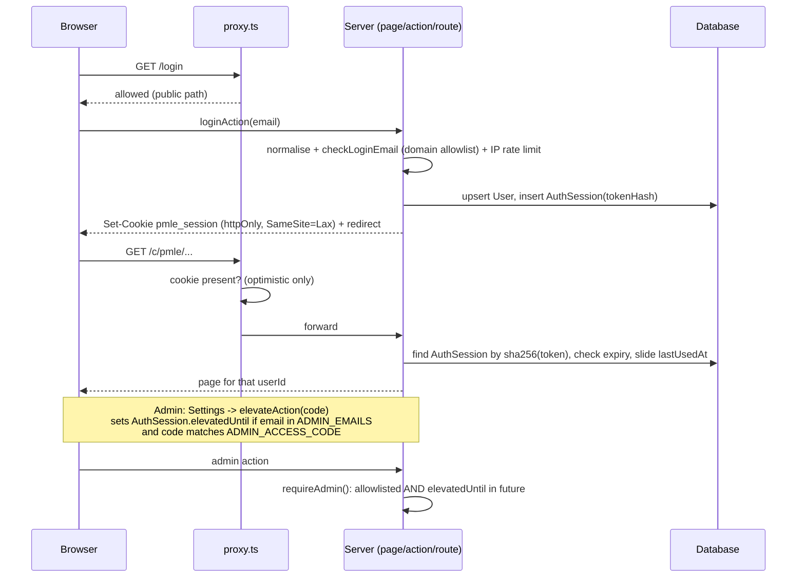
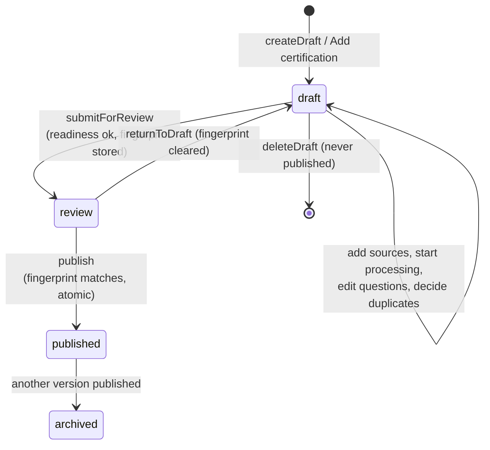
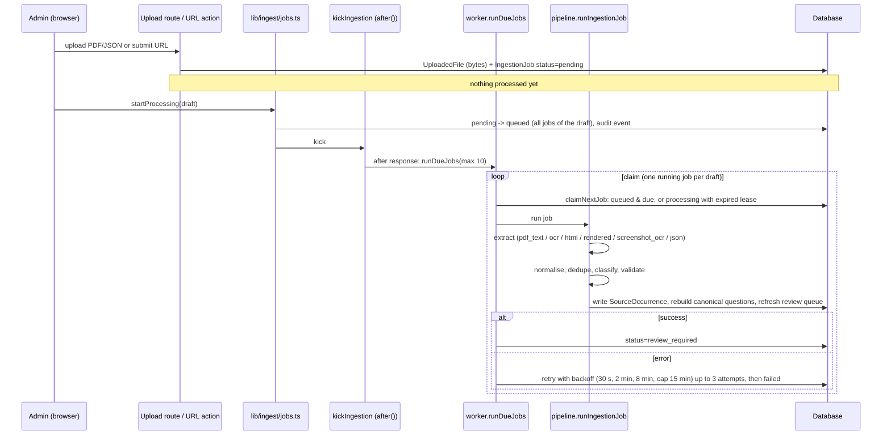
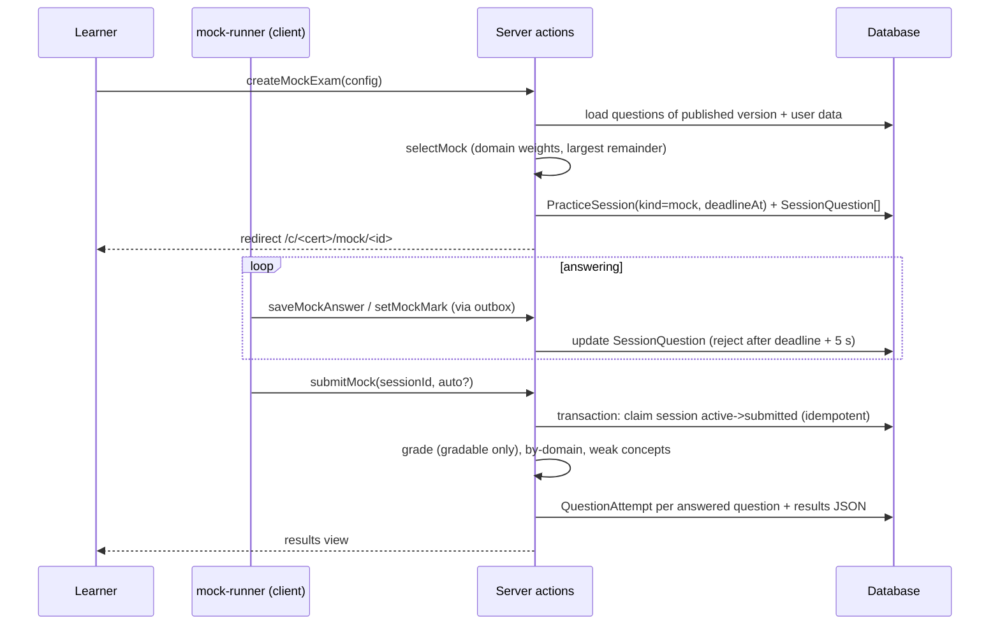

# System architecture

Audit baseline: 2026-11-20. Describes how the application is structured and how its parts communicate. Feature status is in [../CURRENT_STATE.md](../CURRENT_STATE.md); data model in [DATABASE.md](DATABASE.md). Diagrams reflect the code as read on the baseline date.

## 1. High-level architecture

A single Next.js 16 application (App Router) serves pages, server actions and route handlers from one Node.js process. There is no separate API service, queue or cache. State lives in one relational database (SQLite locally, PostgreSQL/Neon in production). Ingestion work runs in the same process after a response is sent, or in an optional separate Node process (`npm run ingest:worker`) against the same database.

```mermaid
flowchart LR
  subgraph Browser
    UI[React client components]
    OB[Autosave outbox<br/>lib/sync-client.ts<br/>localStorage + BroadcastChannel]
  end
  subgraph "Next.js server (one Node process)"
    PX[proxy.ts<br/>cookie gate + headers]
    RSC[Server Components<br/>pages read via Prisma]
    SA[Server actions<br/>lib/*-actions.ts, lib/actions.ts]
    API[Route handlers<br/>app/api/*]
    ING[Ingestion runner<br/>lib/ingest via after()]
    BK[Backup scheduler<br/>instrumentation.ts]
  end
  subgraph "Optional"
    WK[ingest worker CLI<br/>scripts/ingest-worker.ts]
  end
  DB[(SQLite file or<br/>PostgreSQL on Neon)]
  EXT[External: websites,<br/>python, tesseract, chromium]

  UI --> PX
  OB -->|server actions| PX
  PX --> RSC
  PX --> SA
  PX --> API
  RSC --> DB
  SA --> DB
  API --> DB
  SA -->|kickIngestion| ING
  ING --> DB
  ING --> EXT
  WK --> DB
  WK --> EXT
  BK --> DB
```

Layering inside the repository:

| Layer | Location | Role |
|---|---|---|
| Routing and rendering | `app/` | Pages, layouts, route handlers |
| UI components | `components/` | Client interaction, forms, runners, autosave |
| Business logic and data access | `lib/` | Server actions, domain rules, Prisma calls |
| Ingestion | `lib/ingest/` | Adapters, pipeline, jobs, worker |
| Offline tooling | `scripts/` | DB provider switch, PMLE import, backups, copy, worker CLI, Python pipeline |

## 2. Frontend and backend communication

- **Reads.** Server Components call Prisma directly through functions in `lib/` (for example `lib/questions.ts`, `lib/cert.ts`, `lib/quality.ts`). Data reaches the browser as rendered HTML/props. Pages are dynamic (no static caching of user data).
- **Writes.** Mutations are server actions (`"use server"`). Two styles:
  1. **Autosave actions** (`lib/actions.ts` through the `sync()` wrapper) return an `Ack` (`{ok:true,...}` or `{ok:false, code}`) instead of throwing, so the client can tell "retry later" (thrown network/server error) from "never will succeed" (`INVALID`, `NOT_FOUND`) and "sign in again" (`UNAUTHENTICATED`). They are called only by the outbox.
  2. **Command actions** (admin and session creation) are called from event handlers with `callServer()` and return data or throw domain errors (`VersionError`, `IngestError`) converted to messages.
- **Outbox.** Learner changes are placed in a per-user queue (`lib/sync-client.ts`): one in-flight request per record key, newer changes merged into the pending one, a client timestamp `rev` on every write, retry with exponential backoff (1 s doubling, capped at 30 s, jittered), persistence to `localStorage`, a 20-second send timeout (`SEND_TIMEOUT_MS`), cross-tab coordination through `BroadcastChannel("pmle-sync")`, and a pause while the session is expired. The server ignores writes with an older `rev` than stored (`clientUpdatedAt`), which makes retries and out-of-order delivery safe.
- **Route handlers** are used where a server action does not fit: file download/upload (`/api/pdf`, `/api/ingest/upload`, backups, exports), JSON health.
- **Request limits.** Proxy body size 26 MB (upload route), server-action body size 2 MB (`next.config.ts`).

## 3. Backend to database communication

- One shared Prisma client (`lib/db.ts`), created once per process (global cache in development). Provider is chosen by the `DATABASE_URL` prefix; PostgreSQL uses a pooled `DATABASE_URL` for queries and `DIRECT_URL` only for migrations.
- Multi-step operations use interactive transactions (`prisma.$transaction`) with a transaction timeout constant (`TX` in `lib/versions.ts`): publish, delete draft, mock submit, ingestion writes, restore.
- Bulk writes in ingestion use typed raw SQL in `lib/bulk.ts` with schema-qualified table names (the Neon pooler does not preserve `search_path`).
- Concurrency control uses conditional `updateMany` (compare-and-set on status, fingerprint, or `currentVersionId`) rather than row locks. See publish below.

## 4. Authentication and authorization flow



- `proxy.ts` only checks that a cookie exists; it does not trust it. Every page, action and API handler resolves the user from the database (`requireUser`, `apiUser`, `certAdminPage`), and every personal query filters by that user's id; user ids are never accepted from the client.
- Content visibility: learners can load only `published`/`archived` versions; admins can load any. Mutating shared content requires an elevated admin (`canManageContent`). State-changing route handlers also reject cross-origin requests (`sameOrigin`).
- Failure modes: unauthenticated page request redirects to `/login?next=...`; unauthenticated API request returns 401 JSON; unauthenticated autosave action returns `UNAUTHENTICATED` (outbox pauses).

## 5. Student workflow

1. Sign in, land on the certification home (`/`), which lists certifications that have a published current version (admins also see drafts).
2. Open `/c/<slug>`: the layout verifies access and loads sidebar counts for the **current published version**.
3. Browse or practise. The client sends answers/flags/notes as outbox entries; the server writes attempt/flag/note rows and returns acknowledgements.
4. Mock exam: `createMockExam` selects questions by domain weight and creates a session with a deadline; answers autosave; `submit` (manual or at the deadline) grades once and stores the result.
5. Progress pages (dashboard, analytics, plan, history) are computed on read from attempts/flags/theory progress; nothing is cached or pre-aggregated.

## 6. Admin and content workflow (state machine)



- Editable states: `draft`, `review` (editing in `review` clears the fingerprint and returns to `draft`). `published`/`archived` are immutable in application code.
- Publish (`publishVersion`, `lib/versions.ts`): in one transaction, verify state and recompute/compare the fingerprint, claim the version (`status review` + fingerprint), move `Certification.currentVersionId` conditionally, archive the previous version, mark `review_required` jobs `published`, write an `AuditEvent`. If any compare-and-set fails, a `VersionError` aborts the transaction.
- Readiness (`checkReadiness`) produces blocking errors (no questions; questions with fewer than two options or no source occurrence; ingestion jobs still running; sources added but not processed; open error-level review items such as low-confidence OCR) and non-blocking warnings (no objectives, undecided duplicates, ungradable questions, unmapped questions, sources whose last attempt failed).

## 7. Ingestion workflow



- Claim and lease: `claimNextJob` takes the next runnable job atomically; `LEASE_MS` is 30 minutes; a crashed worker's job becomes claimable again when the lease expires, and a job with attempts exhausted is failed instead of retried (`lib/ingest/worker.ts`).
- One running job per draft, because each job rebuilds the draft's canonical questions.
- Alternative runner: `npm run ingest:worker` (`scripts/ingest-worker.ts`) polls the same table; leases make it safe to run alongside inline processing. `INGEST_INLINE=off` disables the inline runner.
- Adapters and safety: `lib/ingest/url-safety.ts` rejects private/loopback addresses (unless `INGEST_ALLOW_PRIVATE_HOSTS=1` outside production); `robots.ts` honours robots.txt; access walls produce explicit error codes instead of bypass attempts. Error codes are listed in [../INGESTION.md](../INGESTION.md).
- Python and Tesseract are invoked as child processes (`INGEST_PYTHON`, `INGEST_TESSERACT`); Chromium is launched through Playwright (`INGEST_BROWSER`). Missing tools yield explicit, user-readable errors.

## 8. Exam (mock) workflow



Mock submit grades at most once: the session is claimed with a conditional status update (`status: active` to `submitted`) inside a transaction, so a concurrent or repeated submit cannot write the attempts twice. What a repeated submit returns to the caller was not separately verified.

## 9. Integrations and background processes

| Item | How it runs | Notes |
|---|---|---|
| Inline ingestion | `after()` in the web process (`lib/ingest/kick.ts`) | Bounded: `max 10` jobs per kick, 1 when started for a single job. On serverless hosts this work may be cut short; the lease and retry logic recover it. |
| Ingestion worker CLI | `scripts/ingest-worker.ts` | Optional separate process, same claim logic. |
| Backup scheduler | `instrumentation.ts` starts `lib/backup-scheduler.ts` on boot (Node runtime only) | Default every 24 h on SQLite, off on PostgreSQL; `BACKUP_INTERVAL_HOURS`, `BACKUP_KEEP`, `BACKUP_RETENTION_DAYS`. |
| Manual snapshots | `/api/backup`, `/api/admin/db-snapshot`, `npm run backup` | SQLite file copy; PostgreSQL needs `pg_dump`. |
| Neon | Database only, via Prisma | The `@neon/*` npm packages and `neon.ts` are not used by runtime code. |
| Other external services | none | No email, analytics, payment or LLM calls. |

## 10. Error handling and validation

- **Input validation:** Zod schemas on every server action and route that accepts input (`lib/actions.ts`, `lib/content-actions.ts`, restore format in `lib/progress-io.ts`, ingestion JSON format in `lib/ingest/`). IDs are bounded (`QuestionId`, `ClientId`, `Rev` helpers); note length is capped at 5000.
- **Domain errors:** typed errors (`VersionError` with codes such as `NOT_FOUND`, `LOCKED`, `NOT_READY`, `CONFLICT`; `IngestError` with codes from `INGEST_ERRORS`) are mapped to user-facing messages in the admin UI.
- **Autosave errors:** `Ack` codes plus outbox states (`saving`, `saved`, `offline`, `error`) shown in the sidebar; validation failures are surfaced, not dropped.
- **UI errors:** `app/(portal)/error.tsx` and `app/global-error.tsx` catch rendering errors; one-off calls use `callServer`.
- **Security validation:** safe `next` redirect, same-origin checks on mutations, SSRF guard on URLs, filename sanitising (`safeFileName`), upload size cap (25 MB), constant-time comparison of the admin code, lockout after repeated failures.
- **Logging:** `console` output only (for example `[ingest] inline processing failed`). Structured admin events go to `AuditEvent`. No external error reporting or metrics service is configured.

## 11. Deployment architecture (as supported by the repository)

- Runs as `next build` then `next start` on a Node.js 20.9+ host behind HTTPS (`docs/DEPLOYMENT.md`). The repository contains **no Dockerfile, CI workflow, or hosting configuration**; the production host is **not defined** here and is unknown.
- Database: PostgreSQL (Neon) in production; migrations applied with `npm run db:deploy` using `DIRECT_URL`. Local development uses a SQLite file at `data/pmle.db`.
- Local binaries (Python with PyMuPDF, Tesseract, Playwright Chromium, `pg_dump`) must exist on the server for the corresponding features; none are bundled.
- The application was run locally against the Neon production database and a Neon demo schema during the 2026-11-05 work. Behaviour on an actual production host (HTTPS cookies, `after()` on that platform, background limits) is **unverified**.
- Detailed steps, security checklist and backups: [../DEPLOYMENT.md](../DEPLOYMENT.md).

## 12. Architectural constraints worth knowing

- The Prisma client in `node_modules` targets one provider at a time; mixing SQLite and PostgreSQL work in one checkout requires regenerating.
- Next.js 16 conventions apply: the request gate is `proxy.ts` (formerly middleware); consult `node_modules/next/dist/docs/` before framework-level changes (`AGENTS.md`).
- All learner reads depend on "current published version" resolution (`lib/cert.ts`); changing publish semantics affects every study page.
