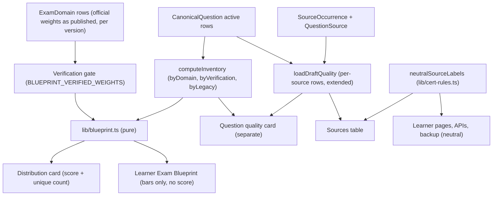

# Questions & Review consolidation, and Exam Coverage & Quality

- Status: Proposed (awaiting approval; nothing implemented)
- Owner / last updated: planning agent, 2026-11-21 (revision 2: complete learner source abstraction, Blueprint Distribution Alignment definition, mandatory production weight verification)
- File name: requested explicitly as `exam-guide-mapping.md`. The folder convention (`NNNN-short-kebab-title.md`, see [README.md](README.md)) would make it `0001-questions-review-and-coverage.md`; rename on approval if preferred.

## 1. Executive summary

Two related changes. There is **no database schema change, no migration, and no change to stored content or user records**.

1. **Questions & Review.**
   - The sidebar's "Question bank" and "Review" groups merge into one group with five entries: All Questions, Marked for Review, Flagged Questions, Incorrect Questions, Bookmarks.
   - The source-specific views (Common, PDF, ExamPrepper) disappear. Their routes redirect to All Questions.
   - Learners never receive source names, URLs, identifiers or identifying metadata, in any page, page data sent to the browser, API response, export, backup file or image URL. Redaction happens on the server.
   - Authorised administrators keep full provenance and every existing source-management, filtering and audit tool.
2. **Exam Coverage & Quality.**
   - The admin Data Quality page (`/c/[cert]/data-quality`, route kept) becomes admin-only and gets a new Overview: the **Blueprint Distribution Alignment** score always shown with the unique question count, the existing "Exam weight vs. question bank share" comparison (moved into a shared component, not rebuilt), a compact domain coverage table, overall question-quality statistics, and per-source summaries labelled "Source", "Source 1", "Source 2" and so on.
   - The learner Exam Blueprint stays, simplified. Personal progress stays in Analytics.

The official exam-guide weights are already stored per content version in `ExamDomain.weightPercent`, parsed from the stored official guide PDF.

- **Before** the alignment score is calculated or displayed, the six production weights must be verified against the official guide (mandatory, read-only, Phase 4B).
- If they differ, the score stays disabled, and production records are not touched.
- Published values (which total 101%) are kept and displayed as published. They are scaled proportionally only inside the calculation.

## 2. Current architecture relevant to this work (verified in code, 2026-11-21)

Read first: [../CURRENT_STATE.md](../CURRENT_STATE.md) sections 4, 7, 8, 9, 11; [../architecture/DATABASE.md](../architecture/DATABASE.md) sections 3.x. Code wins where they differ; differences found are listed in section 3.4.

### 2.1 Navigation and question views

- `components/sidebar.tsx` `certGroups()` builds the groups:
  - "Question bank": All, Common (only when there are 2+ sources), and one `${name} Questions` entry per source linking to `/sources/<id>`.
  - "Review": Marked, Flagged, Incorrect, Bookmarks.
  - "Study": Theory, **Exam Blueprint**, Analytics, Version History.
  - "Content": **Data Quality** (shown to everyone once a version is published), and Data Settings (`showData` = `user.isAdmin`).
- `app/(portal)/c/[cert]/layout.tsx` `sidebarData()` computes the counts (`all`, `common`, `marked`, `flagged`, `incorrect`, `bookmarked`, `issues`) and per-source counts. It also passes `sources` (id, **name**, kind, short) into `CertProvider`. That list is serialised into the page data sent to the browser for **every** user on every certification page.
- All list pages are one server component, `components/question-bank.tsx`, parameterised by `Scope` (`lib/filters.ts`): `all | common | marked | flagged | incorrect | bookmarked | source:<id>`. Route files are thin wrappers (`questions/`, `common/`, `review/`, `flagged/`, `incorrect/`, `bookmarks/`, `sources/[sourceId]/`).
- Data: `lib/questions.ts` `loadQuestionRows(userId, versionId)` loads every **active `CanonicalQuestion`** of the version once, then attaches source refs, user flags, notes, attempts and stats. `filterRows(rows, scope, filters)` applies scope, search, filters and sort in memory. Search, filter, sort, "Practice this list" (`lib/list-actions.ts`), and prev/next/jump on the question page (`questions/[code]/page.tsx`, `?from=<scope>`) all run on the same rows.
- Flags (`QuestionFlag`, kinds `review|flag|bookmark`), notes and attempts are keyed by `(userId, questionId)`, where `questionId` is the `CanonicalQuestion.id`. They are independent of which list view the user came from.
- Legacy URL redirects live in `next.config.ts`: `/common` → `/c/pmle/common`, `/pdf` → `/c/pmle/sources/pdf`, `/examprepper` → `/c/pmle/sources/examprepper`. `lib/filters.ts` also maps the old `?source=pdf_only` and `?sort=pdf_qnum` style parameters.

### 2.2 What "Common Questions" is

- It is **not a separate dataset**. "Common" means canonical questions with non-excluded occurrences in two or more sources (`QuestionRow.isCommon = sourceIds.length >= 2`, `lib/questions.ts`). The sidebar count uses the same definition (`layout.tsx`).
- Source views (`source:<id>`) are canonical questions with at least one occurrence in that source. Common and source views are therefore **overlapping subsets of All Questions**. All Questions is already the deduplicated union (one row per active `CanonicalQuestion`).
- Removing the subset views cannot introduce duplicates or omit questions. All Questions already contains every row those views showed.

### 2.3 Ingestion, deduplication and provenance (retained unchanged)

- `SourceOccurrence` holds one row per question per source (`sourceKey` such as `pdf:84` or `examprepper:136`, plus `sourceId`, `page`, `url`, `extractionMethod`, `excluded`). `lib/canonicalize.ts` merges occurrences into `CanonicalQuestion` using exact and approved fuzzy `DuplicateCandidate` links. Answer keys become `AnswerClaim` rows, and `lib/verification.ts` derives `verification` and `verificationNote`.
- `QuestionSource` (`(versionId, id)`, name, kind, url, file) identifies a source. It is the authoritative source identity and is not touched by this plan.
- **Personal backup and restore** (`lib/progress-io.ts`, format `pmle-prep-progress` v3, served by `/api/me/backup` and `/api/export/progress`):
  - Every attempt, flag, note and session question is referenced as `{ versionId, code, sourceKeys[] }`, where `sourceKeys` are raw keys such as `pdf:84` and `examprepper:136`.
  - `importProgress()` resolves a reference by trying each `${versionId}|${sourceKey}` first, then falling back to `${versionId}|${code}` (following `mergedIntoId` for inactive questions).
  - Versions are matched by id, or by certification + label from another deployment.
  - Sessions are exported with their stored `title` and `config` (which can contain `scope: "source:<id>"` and a `query` with `source=`/`sort=qnum:`).
  - Restore accepts `version` 1..`PROGRESS_VERSION` and rejects newer files.
- **Exhibit images:**
  - `SourceOccurrence.images` is JSON `[{ remote, local }]`.
  - `scripts/pipeline.py` downloads exhibits to `public/question-assets/examprepper/<ep-NNN-i>.png` and stores `local: "/question-assets/examprepper/…"` and `remote: "https://img.examtopics.com/…"` (or `www.examtopics.com/assets/…`).
  - The question card (`StemText`) and the mock runner (`mock/[id]/page.tsx` builds `images` itself) use `local ?? remote`.
  - Static files under `public/` are behind `proxy.ts`'s cookie gate (matcher excludes only `_next/static`, `_next/image`, `favicon.ico`), so any signed-in user can fetch them by path.
  - Local data has 8 exhibit occurrences, all with a local copy.

### 2.4 Official exam guide (the authoritative weights)

| Item | Where | Verified |
|---|---|---|
| Official document | URL `GUIDE_URL` in `scripts/pipeline.py`; stored copy `data/raw/guide/pmle_exam_guide_2026-06-01.pdf` (+ extracted `guide.txt`) | `guide.txt` lines 19, 40, 67, 92, 109, 122 read "(~13/16/21/20/18/13% of the exam)" for Sections 1–6. Whether the live URL still serves the same document was **not** checked (network). |
| Parser | `scripts/pipeline.py` `parse_guide()`: regex `\(~\s*(\d+)%\s*of the exam\)`; asserts 6 sections | code read |
| Processed | `data/processed/taxonomy.json`: `guide_date 2026-06-01`, `weights_sum_percent 101`, `weights_note` "approximate (~) … scaled proportionally" | file read |
| Import | `scripts/import-db.ts` upserts `ExamDomain { versionId, number, title, weightPercent }` and `ExamObjective { code, title, considerations }` | code read |
| Runtime store | `ExamDomain.weightPercent Int?` per `ContentVersion`; `ContentVersion.guideTitle` ("Exam guide effective June 1, 2026") | **local** SQLite `data/pmle.db`, read-only query: version `ver_pmle_2026` has D1 13, D2 16, D3 21, D4 20, D5 18, D6 13 |
| Copying | `lib/versions.ts` copies domains/objectives into new drafts ("guide" or "all") | code read |
| Production (Neon) | `ExamDomain` rows of the published PMLE version | **Not verified.** Mandatory gate in Phase 4B (section 8.6). |

- Weights are **data, not code**: they are per version, immutable once published, and not hardcoded in TypeScript. No UI exists to edit them (CURRENT_STATE section 9, "Missing").
- The official published values sum to **101%** (the guide's approximate "~" values). Existing consumers normalise by the sum: the blueprint bar (`weight / totalW`), `lib/allocation.ts` (`sumW`, with a disclosure when ≠ 100), and the readiness heuristic in `lib/analytics.ts`.

### 2.5 Current Exam Blueprint calculation (`app/(portal)/c/[cert]/blueprint/page.tsx`)

- Top bar: segment width = `weightPercent / Σ weightPercent`.
- Lower bar and per-domain tiles: `share = n_d / mapped`, where `mapped` = questions with a domain. The label is "Proportional" when |share − weight| < 5 percentage points, otherwise "Over-represented" or "Under-represented". The subtraction uses the **raw** weight (not normalised), so the 101% sum leaks in by up to about 0.2 points.
- Below that, a large card for each of the 6 domains: weight, question count, theory progress, and the **learner's own** accuracy. Inside it, each objective has considerations, up to 14 theory-concept chips, attempted/total bars, theory bars, accuracy, and links. This is the "crowded" part.
- Hardcoded layout assumption: `lg:grid-cols-6`.
- `lib/analytics.ts` `domainStats.bankShare` uses a different denominator (`n_d / all rows`, unmapped included). The two pages disagree slightly today.

### 2.6 Current Data Quality page (`app/(portal)/c/[cert]/data-quality/page.tsx`)

- Guard: `certAdminPage()`. **Learners can open it** for the published version (read-only); `?version=` drafts are admin-only. Edits require `canManageContent` (elevated admin) on draft/review versions.
- Tabs: Overview, Questions, Duplicates, Answer conflicts, Review queue, Classification, Outdated content, Import runs.
- Overview contents:
  - The `QualitySummary` card (`loadDraftQuality`, `lib/quality.ts`), with a per-source table showing the **source name**.
  - An inventory identity line ("Unique = PDF question bank + ExamPrepper − overlap…", names joined).
  - Eight inventory stats, several **hardcoded by kind**: "PDF source questions", "Website source questions", "PDF only", "Website only" (`lib/inventory.ts` `pdfSourceQuestions`, `websiteSourceQuestions`, `pdfOnly`, `websiteOnly`).
  - One extraction card per source (title = **name**, subtitle = **URL or file name**, raw import-report facts, access notes).
  - Answer-verification distribution and legacy-currency distribution.

### 2.7 Authorization

- Roles come from `lib/auth.ts`: `isAdmin` (email in `ADMIN_EMAILS`), `canManageContent` (admin and elevated). Admin pages use `certAdminPage()` followed by `if (!user.isAdmin) notFound()` (`data/page.tsx`, `certifications/new/page.tsx`).
- Route handlers use `apiUser()` and check flags themselves (`/api/pdf` checks `canManageContent` only for non-visible versions).
- In this plan, **"learner" means `!user.isAdmin`** and **"authorised administrator" means `user.isAdmin`** (allowlisted; elevation is still required for edits). Every redaction decision is made on the server from `getCurrentUser()`; no client flag decides what is sent.

## 3. Confirmed findings

### 3.1 Feature 1

1. All Questions is already the unified, deduplicated bank. Common and per-source views are subsets of it (section 2.2).
2. Review state is stored per canonical question and user, not per view. Consolidating the navigation cannot detach bookmarks, flags or attempts.
3. The source routes are thin wrappers around `QuestionBank`. They can be removed and replaced by redirects; `QuestionBank` itself does not need restructuring.
4. `?from=` values in existing links and history (`pdf`, `examprepper`, `common`, `source:<id>`) are parsed by `scopeFromParam()`. They must keep resolving, now to `all`, so old question-page URLs still render with working prev/next.
5. `createPracticeSession` validates `mode` with `z.enum(Object.keys(PRACTICE_MODES))` (`lib/actions.ts:328`). Removing the `common` key would break resubmission of saved configs, so it must be hidden from the UI instead of deleted.
6. Local content check (read-only, 2026-11-21): no active stem, option, explanation, topic, subtopic or classification text contains "examtopics" or "examprepper". The leaks are in metadata and structure, not in question text.

### 3.2 Inventory of learner-reachable source exposure

Every learner-reachable path (pages, page data sent to the browser, route handlers, server-action return values, downloadable files, static assets) was reviewed. Server actions that return data to learners (`submitAnswer` → `SubmitResult`, sync acks, `createPracticeSession`, `createMockExam`, `createPracticeFromList`, `importProgress` summary) contain no source fields. Mock results JSON (`lib/mock.ts`) has no source fields.

| # | Where | What leaks | Fix (phase) |
|---|---|---|---|
| L1 | `components/sidebar.tsx` | "Common Questions" and "`<name>` Questions" entries | removed (1) |
| L2 | `layout.tsx` → `CertProvider.sources` | id, name, kind of every source in the page data sent to the browser on every page | `[]` for learners (2) |
| L3 | `components/question-bank.tsx` | `SourceBadges` ("PDF 84", "EP 136"), "Common" badge, scope title and description | hidden for learners (1, 2) |
| L4 | `components/filter-bar.tsx` | source select, "`<name>` question #" sort, placeholder "pdf 12, ep 12" | disappear with empty `sources`; enforced on the server (2) |
| L5 | `lib/questions.ts` | search syntax `pdf 84` / `ep:136`; source ids and keys in `searchText` | admin-only `sourceText` (2) |
| L6 | `components/question-card.tsx` `MetadataPanel` | source names, `/api/pdf` link, external URLs, page numbers, `topicLabel` | neutral label, no links (2) |
| L7 | `components/question-card.tsx` feedback | `CLAIM_LABEL` "PDF answer key", "ExamPrepper answer", "ExamTopics original key" | neutral kinds and labels (2) |
| L8 | `CanonicalQuestion.verificationNote` (stored text) | "PDF and ExamPrepper keys agree…", "Only the PDF…", "ExamTopics' original key…" | not sent to learners; generic help shown (2) |
| L9 | `lib/verification.ts` `VERIFICATION_HELP.contested` | "the ExamTopics key dissents" | neutral wording (2) |
| L10 | `lib/question-data.ts` `QuestionCardData` | `occurrences[].source/key/url/originUrl/page/pageEnd/topicLabel`, `claims[].kind/sourceKey`, `explanations[].sourceKey`, `images[].remote/local` | redacted when the server builds the card data (2) |
| L11 | `app/(portal)/c/[cert]/page.tsx` "Question inventory" card | per-source counts and names, "`<name>` only" badges, links to `/sources/<id>`, `/common`, `/data-quality` | neutral card (2) |
| L12 | `/c/[cert]/data-quality` (learner read-only) | everything in section 2.6 | 404 for learners (3) |
| L13 | `/api/pdf` | the published source PDF; with no parameters it serves the PMLE PDF | admin-only (2) |
| L14 | `/api/export/questions` (linked from Settings for everyone) | `sources` (keys), `sourcePage`, `sourceUrl` | omitted for learners (2) |
| L15 | `lib/selection.ts` `PRACTICE_MODES.common` | "present in both sources" | hidden (1) |
| L16 | `PracticeSession.title` (stored), shown on Dashboard Resume, Practice list, practice header | "`<source name>` Questions" for sessions started from a source list | neutral display title (2) |
| L17 | Exhibit image URLs in card and mock data | `local` path `/question-assets/examprepper/ep-024-0.png`; `remote` `examtopics.com` host | neutral authenticated `/api/exhibit` URL for learners (2) |
| L18 | `/api/me/backup`, `/api/export/progress` | `sourceKeys` (`pdf:84`, `examprepper:136`) on every reference; session `title`; session `config.scope`/`config.query` | backup format v4 with neutral references and sanitised session metadata; v1–v3 restore kept (2) |
| L19 | `components/question-card.tsx` | "Neither source provides an explanation" (implies exactly two sources) | neutral text (2) |
| L20 | `components/question-card.tsx` `MetadataPanel` summary line | `${short} Q${qnum}` built from `cert.sources` (falls back to the raw id upper-cased) | uses server-provided neutral label (2) |

### 3.3 Feature 2

1. The weight-vs-share comparison is plain JSX inside `blueprint/page.tsx`. It can be extracted into a server component with props and reused unchanged.
2. `loadDraftQuality()` already computes per-source extracted, valid, invalid, excluded, edited, OCR, shared and open issues **from occurrences**. It does not compute per-source verification or legacy counts, but it already loads `canonical` rows and a `sourcesOf` map, so adding them is cheap and additive.
3. `computeInventory()` already gives overall `uniqueQuestions`, `confirmedOverlap` (questions in 2+ sources), `byVerification`, `byLegacy`, `byDomain` (including `unmapped`), and `identityHolds` (a count-consistency check). Overall statistics count canonical questions once each, so there is no double counting.
4. The legacy status labels already exist (`lib/filters.ts` `LEGACY_LABEL`): `renamed_service` = "Legacy name", `deprecated_feature` = "Deprecated", `possibly_outdated` = "Needs verification", `verified_obsolete` = "Obsolete". These match the requested per-source metrics.
5. Local data snapshot (SQLite dev DB, **not production**, read-only, 2026-11-21):
   - 339 active questions, of which 2 are unmapped.
   - Per domain: D1 56, D2 103, D3 67, D4 41, D5 32, D6 38.
   - Verification: verified 284, conflict 28, contested 21, source_key 6.
   - Legacy: renamed_service 46, deprecated_feature 16, possibly_outdated 8.
   - Two sources: `pdf` ("PDF question bank", pdf) and `examprepper` ("ExamPrepper", website).
6. `scripts/ingest/pdf_extract.py` is a read-only PyMuPDF text extractor (`python scripts/ingest/pdf_extract.py <file.pdf>` prints JSON pages). It can be reused by the weight verifier without new dependencies.

### 3.4 Documentation vs code

- The brief describes Exam Blueprint and Data Quality as "administrative pages". In code, Blueprint is a learner Study page with personal progress, and Data Quality is visible to learners read-only. The two approved decisions in section 4 resolve this.
- CURRENT_STATE.md section 7 ("read-only Data Quality for the published version" for learners) is accurate today and becomes outdated after Phase 3.

## 4. Decisions

### 4.1 Already established by the codebase (kept)

- Published versions are immutable. Progress is per version and per canonical question (`QuestionFlag`, `QuestionAttempt`, `QuestionNote` keyed by `questionId`).
- Canonical questions are the unit learners see. Sources are provenance below them.
- Exam weights are per-version `ExamDomain` rows, normalised by their sum wherever they are used.
- Server Components query Prisma directly. There is no REST layer for pages. Admin pages are guarded with `notFound()`.

### 4.2 Approved

- **D1 Learner Exam Blueprint (2026-11-21):** keep a simplified learner page with official weights, the shared share comparison, and objectives with considerations. Personal progress lives in Analytics.
- **D2 Source abstraction depth (2026-11-21, made complete in revision 2):** learners receive no original source names, URLs, identifiers, file names, page numbers, source-site topic labels, or source-specific claim kinds. This applies to the UI, page data sent to the browser, APIs, question details, search, filters, sorting, exports, backups and image URLs. Learners see only neutral labels ("Source", "Source 1…N"). Authorised administrators keep everything (section 10.3).
- **D15 Metric name and scope (revision 2):** the score is called **Blueprint Distribution Alignment**. It measures only how closely the question-bank distribution across exam domains matches the official exam-domain weight distribution. It is admin-only, always shown with the unique question count, never combined with quality metrics, and never presented as readiness, completeness, answer accuracy or quality.
- **D16 Mandatory production weight verification (revision 2):** before the score is calculated or displayed, all six production `ExamDomain` weights must be verified against the official guide (section 8.6). Production records are never modified by this work. A mismatch blocks the score.

### 4.3 Recommended defaults (needing approval; each can be changed without restructuring)

| ID | Decision | Recommendation | Alternative |
|---|---|---|---|
| D3 | Route and name of the consolidated page | Keep route `/c/[cert]/data-quality`. Rename title and nav label to **Exam Coverage & Quality**; the Overview tab becomes the new dashboard. Draft links from Data Settings (`?version=`) and the other tabs keep working with no redirect. | New route `/coverage` plus a redirect from `/data-quality`. |
| D4 | Who may open it | `isAdmin` (allowlisted), read-only without elevation, same as Data Settings. Learners get 404. | Elevated admins only. |
| D5 | Detailed tabs (Questions provenance, Duplicates, Answer conflicts, Import runs) | Keep **real** source names and URLs there. They are admin-only investigation tools, and auditing needs the actual page or URL. Neutral labels apply to the summary only. The per-source extraction-report cards move from Overview to the Import runs tab. | Neutral labels in the tabs too. Hurts traceability. |
| D6 | Share denominator | All active questions. Unmapped questions appear as a grey "Unmapped" segment or row only when there are any, so bars, table and score agree. The learner Blueprint uses the same component. | Mapped questions only (current Blueprint behaviour). |
| D7 | Proportionality threshold | Keep ±5 percentage points, compared against the **scaled** (normalised) weight. | Raw-weight comparison. |
| D8 | Meaning of "Questions requiring verification" | Legacy status `possibly_outdated` (existing label "Needs verification"). Answer verification is shown separately as Verified / Single-source key / Conflict or contested / No answer. | "Answer not verified". |
| D9 | Show source kind (PDF/Website/Import) in the admin summary | Do not show it. | Show it. |
| D10 | Learner question list badges | Remove `SourceBadges` and "Common" for learners. Question page shows "Source 1 · Question 84" without links. | Neutral badges in lists. |
| D11 | Learner exhibit images | New authenticated route `GET /api/exhibit?q=<canonicalId>&i=<index>`. It checks the question's version is visible, reads the primary occurrence's `images[i].local`, and streams the file. The path must start with `/question-assets/` and resolve inside `public/`. Learner card and mock data contain only this URL. If an exhibit has no local copy, learners see the existing "[exhibit unavailable]" placeholder and the gap is counted for admins. Files are **not moved or renamed**. | Move assets to neutral paths and rewrite `images` JSON (a content-data change, rejected). Or keep the paths visible (rejected by correction 1). |
| D12 | Neutral label order | Existing source display order `orderBy [kind asc, id asc]`, per version. Stable for a published version, which is immutable. Used identically for UI labels and backup references. | Order by first ingestion job `createdAt`. |
| D13 | Run-time verification gate | New environment variable `BLUEPRINT_VERIFIED_WEIGHTS` (format `<versionId>=<w1>,<w2>,…[;…]`). It is set only after the Phase 4B check passes, holding the verified production values. The score is computed only when the version's current `ExamDomain` weights (ordered by domain number) are exactly equal to its entry. A missing entry shows "not yet verified"; a different entry shows "weights differ from the verified official values". This fails closed, works per version and certification, and needs no schema change. TypeScript contains no weights. | Release checklist only (no run-time gate). This cannot stop the score if data changes later. |
| D14 | Backup format | Bump to **v4** for every user. References carry `sourceRefs` (neutral aliases `#<n>:<qnum>`, where `n` is the D12 index; `#` cannot occur in real source ids, whose regex is `^[a-z0-9][a-z0-9_-]{0,39}$`) instead of raw `sourceKeys`. Session `title` uses the neutral display title, and `config.scope`/`config.query` drop source scopes, `source=` and `sort=qnum:`. Restore accepts v1–v4. Resolution order: raw `sourceKeys` (v1–v3), then `sourceRefs` (v4), then `versionId + code` (unchanged fallback). | Keep raw keys and document the leak (rejected by correction 1). Or keep raw keys for admins only (two formats; rejected for simplicity). |

### 4.4 Unresolved questions

- U1. **Blocking for Phase 4C:** do production `ExamDomain` weights for the published PMLE version equal the official guide's 13/16/21/20/18/13? (Phase 4B.)
- U2. Is the stored guide PDF still the document served at `GUIDE_URL`? A revised guide would be a new content version and out of scope; it is detected in Phase 4B.
- U3. Do any production `PracticeSession.title` values contain source names? Read-only count in Phase 2; the display mapping handles them either way.
- U4. Do all production exhibit images have a local copy? Read-only check in Phase 2; any gap becomes an admin-visible count, not a learner leak.

## 5. Proposed navigation

```
Dashboard · Study Plan · Practice · Mock Examination
QUESTIONS & REVIEW
  All Questions (n)
  Marked for Review (n)
  Flagged Questions (n)
  Incorrect Questions (n)
  Bookmarks (n)
STUDY
  Theory Checklist · Exam Blueprint (simplified) · Analytics · Version History
CONTENT (admins only)
  Exam Coverage & Quality (open issues)   [when a version is published]
  Data Settings
All certifications · Settings
```

URL compatibility (all `permanent: false`, query strings preserved by Next.js):

| Old URL | New behaviour |
|---|---|
| `/c/:cert/common`, `/c/:cert/common/...` | → `/c/:cert/questions` |
| `/c/:cert/sources/:id` | → `/c/:cert/questions` |
| `/common`, `/pdf`, `/examprepper` (pre-multi-cert) | → `/c/pmle/questions` directly (no double hop) |
| `/c/:cert/questions/Q-0042?from=pdf` or `from=source:x` or `from=common` | renders; list context = All Questions |
| `/c/:cert/review`, `/flagged`, `/incorrect`, `/bookmarks`, `/questions` | unchanged |
| `?source=…`, `?sort=qnum:…`, source search syntax for learners | ignored on the server (filter dropped, default sort, plain-text search) |
| Same parameters for admins | unchanged (admins keep "In two or more sources", "`<name>` only", source question-number sort and `pdf 84` search) |
| `/c/:cert/data-quality` for learners | 404 (was read-only) |
| `/c/:cert/blueprint` | unchanged URL; simplified content; `#obj-<code>` anchors kept for `theory/[id]` links |

## 6. Proposed Exam Coverage & Quality layout (Overview tab)

Reuses `Card`, `CardHeader`, `Stat`, `Badge` and `ProgressBar` from `components/ui.tsx` and the badges from `components/badges.tsx`. No new chart library and no new visual primitives.

1. **Distribution card** (`data-testid="distribution-alignment"`). One `Stat`:
   - Label "Blueprint Distribution Alignment", value e.g. "81 / 100".
   - In the same element, always: "Domain mix of **339 unique questions** (2 unmapped) compared with the official exam-domain weights."
   - Fixed explanatory line: "Measures only how closely the bank's distribution across exam domains matches the official exam-guide weights. It does not measure exam readiness, content completeness, answer accuracy or question quality."
   - Verification status line: "Official weights verified" when the D13 gate passes; otherwise the score is replaced by "Unavailable: weights not yet verified against the official exam guide" or "Unavailable: weights differ from the verified official values — investigate". The unique question count stays visible in every state.
   - Tooltip: the formula of section 8.1 and the limitations of section 8.5.
2. **Exam weight vs. question bank share**: the extracted `BlueprintShare` component (same two bars, same colours, same legend). Below it, a muted line: "Official weights from `<guideTitle>`, shown as published. The published values total `<Σ>`%; for the comparison and the score each is scaled proportionally (weight ÷ `<Σ>`)."
3. **Domain coverage**: one compact table (replaces the six large domain cards on this page). Columns:
   - Domain (number and short title);
   - Official weight (published %, unmodified);
   - Bank share;
   - Questions;
   - Difference (signed percentage points against the scaled weight);
   - Status (Proportional / Over / Under, same tones as today).

   Optional final line, only when non-empty: "Objectives with no questions: 2.3, 5.2" linking to the Classification tab.
4. **Question quality** (separate card, `data-testid="question-quality"`, never merged with item 1). `Stat`s for:
   - Total questions;
   - Found in 2+ sources (`confirmedOverlap`), with hint "merged duplicates: X · decisions pending: Y";
   - Answer conflicts (conflict + contested);
   - Open review items;
   - the answer-verification breakdown (existing `VerificationBadge` rows);
   - the legacy breakdown (Legacy name / Deprecated / Needs verification / Obsolete);
   - exhibits without a local copy (from D11).

   The existing `QualitySummary` validity metrics (valid, invalid, unmapped, gradable, edited) stay in this card's second row.
5. **Sources**: one small table, one row per source, labelled "Source" when there is only one, otherwise "Source 1…N". Columns:
   - Extracted (live occurrences);
   - In bank (distinct canonical questions);
   - Shared (also in another source; hidden with a single source);
   - Verified (`verified` + `user_verified`);
   - Answer conflicts;
   - Legacy name;
   - Deprecated;
   - Needs verification;
   - Open issues (errors / warnings);
   - Status (`processed`, `failed`…).

   Footnote: "A question found in several sources is counted under each of them; totals above count it once." A link "Source details → Data Settings" leads admins to the real names.

Removed from Overview: the name-based identity line, the kind-hardcoded inventory stats, and the extraction-report cards (moved to Import runs, per D5).



## 7. Official exam guide integration

- Read weights only from `ExamDomain` for the version being viewed (published, or the `?version=` draft for admins). No constants in code. No new storage. No writes.
- **Preservation:** published values (`weightPercent`, integers with the guide's "~" meaning) are stored, displayed and compared **exactly as published**. They are never rewritten, rounded or normalised in the database, in fixtures copied from production, or in the verification record.
- **Normalisation (calculation only):** `w_d = weightPercent_d / Σ_k weightPercent_k` (proportional scaling, the same method `lib/allocation.ts` and the current bars use). It is computed in memory for the share comparison, the Difference column and the score; it is never persisted.
  - PMLE values: Σ = 101, so w = 13/101 ≈ 12.871%, 16/101 ≈ 15.842%, 21/101 ≈ 20.792%, 20/101 ≈ 19.802%, 18/101 ≈ 17.822%, 13/101 ≈ 12.871%. The scaled weights total exactly 100%.
- Guards:
  - No domains: show "This version has no exam guide; distribution alignment cannot be computed".
  - Any `weightPercent` is null, or the sum is 0: score "n/a" with the domains that lack weights listed. This prevents the division by zero that exists today (`totalW = 0` gives NaN widths in `blueprint/page.tsx`).
  - Weights not matching the D13 verified entry: score unavailable (section 6, item 1).
- Show provenance with `ContentVersion.guideTitle` (for example "Exam guide effective June 1, 2026"). The guide's URL lives in `scripts/pipeline.py` and `data/processed/taxonomy.json` and is not displayed.
- Multi-certification: everything is per version. A certification or version without a verified entry shows "not yet verified" and nothing else breaks.

## 8. Blueprint Distribution Alignment methodology

### 8.1 Definition and calculation

Inputs, for one content version:

- N = number of **unique** active canonical questions. Each question is counted once regardless of how many sources contain it, so it is never double-counted across sources.
- n_d = number of those questions classified to domain d (`CanonicalQuestion.domainNumber`).
- u = N − Σ_d n_d = unmapped questions.
- p_d = official published weight of domain d (`ExamDomain.weightPercent`, as published).
- w_d = p_d / Σ_k p_k (scaled weight, section 7).

```
share_d = n_d / N
BDA     = 100 × Σ_d min(share_d, w_d)                                  range 0 to 100
        = 100 × (1 − TVD),   TVD = ½ × ( Σ_d |share_d − w_d| + u / N )
```

- Unmapped questions form an extra category with target weight 0. They count as misaligned mass and can never raise the score.
- Display: the score is rounded **down** to an integer (100 appears only for an exact match), with one decimal in the tooltip.
- Undefined (shown as "n/a", never 0) when N = 0, when there are no domains, when any weight is null, when Σ p = 0, or when the D13 gate does not pass.

### 8.2 What it measures and what it does not

- **It measures** how closely the bank's distribution across exam domains matches the official exam-domain weight distribution.
- 100 means the bank's domain mix equals the scaled official weights. 0 means no overlap.
- 100 − BDA is the **minimum percentage of questions** that would have to be added to, removed from, or moved between domains for the mix to match. This is the standard total-variation interpretation.
- Over- and under-representation are treated symmetrically. Every point over in one domain is matched by a point under elsewhere.
- **It does not measure** exam readiness (the learner Dashboard's separate "Readiness heuristic" is unrelated and unchanged), content completeness (objective coverage, number of questions), answer accuracy, or question quality.
- It does not depend on bank size. A 40-question bank can score as high as a 4,000-question bank. That is why the unique question count is always displayed with it (section 6, item 1) and asserted in tests (Phase 4C).
- It is shown only on the admin page, in its own card, and is never averaged, weighted or combined with any quality statistic.

### 8.3 Illustration (local SQLite dev data, 2026-11-21; not a production result)

With D1..D6 = 56/103/67/41/32/38, 2 unmapped, N = 339, and published weights 13/16/21/20/18/13 (Σ = 101, scaled as in section 7):

- Differences in percentage points: D1 +3.6, D2 +14.5, D3 −1.0, D4 −7.7, D5 −8.4, D6 −1.7.
- BDA ≈ **81.2** (81.5 if unmapped questions were excluded).
- The real value is computed only by the implementation from production data **after** Phase 4B passes. It must not be quoted from this plan or hardcoded.

### 8.4 Alternatives considered

| Measure | Why not primary |
|---|---|
| Mean absolute deviation (pp) | Scale depends on the number of domains; no natural 0–100. |
| Chi-square / p-value | Grows with N, so large banks always "fail"; the bank is not a sample of the exam. |
| KL or Jensen-Shannon divergence, Hellinger | Sound but hard to explain; JS needs log handling for empty domains. |
| Max single-domain deviation | Ignores all but the worst domain. Still visible as context in the Difference column. |

### 8.5 Limitations (shown in the tooltip)

- Distribution only (section 8.2).
- It inherits classification error. Domains come from the keyword classifier (low-confidence or manual classifications are visible in the Classification tab).
- The official weights are approximate ("~") and total 101%. Scaling is required, and differences below about 1 pp are not meaningful.
- Small banks: single questions move the score noticeably. N is always shown.
- Absolute sufficiency ("enough questions for a 60-question mock?") is answered by `lib/allocation.ts` at mock time with disclosed shortfalls. It is deliberately not part of this score.

### 8.6 Mandatory official weight verification (pre-release, read-only)

This must pass before the score is calculated or displayed (Phase 4B gates Phase 4C). It is repeated whenever a new version of any certification would show the score (each needs its own D13 entry).

1. **Authoritative document.**
   - Compute the SHA-256 of the stored guide `data/raw/guide/pmle_exam_guide_2026-06-01.pdf`.
   - Download the official guide from `GUIDE_URL` to a temporary location **outside the repository** and compare hashes.
   - If the hashes differ, extract the live document's weights too. If its weights differ from the stored copy, **stop**: the official guide has been revised, and that requires a new content version (out of scope).
   - If the URL cannot be reached from the verification environment, a person must open the official guide page and confirm the six values by eye. One of the two checks is mandatory; if both are impossible, the gate fails.
2. **Official values.**
   - Extract section number, title and "(~N% of the exam)" for every section with `scripts/ingest/pdf_extract.py`, parsed with the same rule as `parse_guide()`.
   - Expect exactly 6 sections for PMLE.
   - A person also reads the six values from the PDF; both readings must agree.
3. **Production values (read-only).**
   - Read the `ExamDomain` rows of the PMLE certification's current published version (`Certification.currentVersionId`), using the schema named in the production `DATABASE_URL`. For example: `SELECT d.number, d.title, d."weightPercent" FROM "ExamDomain" d JOIN "Certification" c ON c."currentVersionId" = d."versionId" WHERE c.slug = 'pmle' ORDER BY d.number`.
   - Run it through a read-only path only: the Neon SQL editor or Neon MCP `run_sql` with a SELECT statement, `psql` with `default_transaction_read_only=on`, or the verifier script below.
   - Never run migrations, imports, `npm run setup`, tests or any writing script against Neon.
4. **Compare.**
   - Same number of domains; numbers 1..6 with none missing or extra; each `weightPercent` exactly equal to the official integer; Σ recorded (expected 101).
   - Titles are compared too. A title mismatch is flagged for investigation and also blocks the gate until it is explained.
5. **Record.** Add an entry to the Verification log (section 14): date, verifier, guide SHA-256 (stored and live), official values, production version id and values, result.
6. **On pass.** Set `BLUEPRINT_VERIFIED_WEIGHTS=<productionVersionId>=<w1>,…,<w6>` in the production environment, copied from the **production** values that matched. This is configuration, not data. Then Phase 4C may be released.
7. **On mismatch.**
   - Do not set the variable. Do not modify, normalise or overwrite any production record. Do not "fix" either side.
   - Record the discrepancy (which domain, official vs production), set this plan's status note to "Blocked: weight discrepancy", and stop Phase 4C until a separate investigation decides which side is wrong. Any data correction would go through a new draft version and publish, which is outside this plan.
   - Phases 4A, 5 and the rest of the page may still ship. They display the stored weights exactly as today's Blueprint does, with the score shown as unavailable.

**Verifier script (proposed, Phase 4B):** `scripts/verify-exam-weights.ts`.

- Usage: `npx tsx scripts/verify-exam-weights.ts --guide <pdf> [--live] --cert pmle`.
- It runs `pdf_extract.py`, parses the sections with the pure `parseGuideWeights()` (in `lib/blueprint.ts`), and reads `ExamDomain` with Prisma `findMany` only. The script contains no create, update, delete, upsert, `$executeRaw` or transaction calls; this is reviewed and asserted by a unit test that scans the file for those calls.
- It prints a comparison table and the proposed `BLUEPRINT_VERIFIED_WEIGHTS` value, and exits non-zero on any mismatch.

## 9. Impact analysis

### 9.1 Database

**None.**

- No models, fields, indexes, migrations (SQLite or PostgreSQL), backfills or data rewrites.
- `ExamDomain`, `QuestionSource`, `SourceOccurrence` (including `images`), `AnswerClaim`, `CanonicalQuestion.verificationNote`, `PracticeSession.title`/`config` and all user tables are read, never written, by this work.
- Legacy columns `inPdf` and `inExamprepper` stay.

### 9.2 Server, API and route changes

| File | Change | Kind |
|---|---|---|
| `next.config.ts` | Add redirects `/c/:cert/common(/*)`, `/c/:cert/sources/:id` → `/c/:cert/questions`. Point `/common`, `/pdf`, `/examprepper` at `/c/pmle/questions`; drop `common` from `LEGACY_SECTIONS`. | modify |
| `app/(portal)/c/[cert]/common/page.tsx`, `sources/[sourceId]/page.tsx` | Delete; redirects take over. | remove |
| `app/api/pdf/route.ts` | Require `user.isAdmin` (404 otherwise); keep the draft rule. | modify (access tightened) |
| `app/api/exhibit/route.ts` (**new**) | D11: authenticated exhibit stream by `q` + `i`. Visible versions for everyone; drafts for `canManageContent`. Path confined to `public/question-assets/`. `cache-control: private`, `x-content-type-options: nosniff`, content type from an allowlist (png/jpg/gif/webp). | add |
| `app/api/export/questions/route.ts` | For learners, omit `sources`, `sourcePage`, `sourceUrl` (JSON fields and CSV columns). Admins unchanged. | modify |
| `app/api/me/backup/route.ts`, `app/api/export/progress/route.ts` | No code change; they serve `exportProgress()`, which now emits v4 (D14). | none |
| `app/api/me/restore/route.ts` | No code change; `importProgress()` accepts v1–v4. | none |
| `lib/list-actions.ts` | Strip learner-forbidden filters and scopes (same helper as pages). | modify |
| Server actions in `lib/actions.ts` | None. `PRACTICE_MODES.common` kept for validation compatibility. | none |
| `.env.example` | Document `BLUEPRINT_VERIFIED_WEIGHTS` (empty by default; set only after Phase 4B). | modify |
| `scripts/verify-exam-weights.ts` (**new**, read-only) | Section 8.6 verifier. | add |

### 9.3 Library changes

| File | Change |
|---|---|
| `lib/blueprint.ts` (**new**, pure, no Prisma) | `blueprintDistribution(domains: {number, title, weightPercent}[], byDomain: Record<string, number>)` returns `{ total, unmapped, weightSum, score: number \| null, reason?, rows: {number, title, publishedWeight, scaledWeight, count, share, diffPp, status}[] }`. `parseVerifiedWeights(env)` returns a `Map<versionId, number[]>`. `verificationState(versionId, domains, map)` returns `"verified" \| "unverified" \| "mismatch"`. `parseGuideWeights(text)` returns `{ number, title, weight }[]`. The single source for the score, table, learner bars, gate and verifier. |
| `lib/cert-rules.ts` | `neutralSourceLabels(ids: string[])` returns a `Map<id, { index, label, short }>`: one source gives "Source" / "S"; several give "Source i" / "S i". `neutralSourceRef(index, sourceKey, sourceId)` returns `#<index>:<qnum part>`. Pure; shared by UI, export and backup. |
| `lib/filters.ts` | `scopeFromParam`: `common`, `pdf`, `examprepper` and `source:*` map to `all`. Remove `sourceScope`, `scopeSourceId`, the source branch of `scopeMeta`, and `SCOPES.common` once unused. `SCOPES.all.description` becomes "Every unique question in the bank." New `learnerFilters(f, isAdmin)` drops `source` and `qnum:` sort for non-admins. New `displaySessionTitle(title, config, isAdmin)` returns "All Questions" (plus " (filtered)" when the original had it) for learners when `config.scope` is `common` or `source:*`. |
| `lib/questions.ts` | Remove the `source:`/`common` scope branches. Move source tokens out of `searchText` into `sourceText`. `filterRows(rows, scope, f, { sourceSearch })` uses the source syntax and `sourceText` only when `sourceSearch` is true (admins). |
| `lib/question-data.ts` | `toCardData(detail, gradeContested, view)` with `view` = `{ admin: true, names }` or `{ admin: false, labels }`. Occurrences carry `sourceLabel` and `kind`. **Learners:** `source`/`key` become neutral aliases; `url`, `originUrl`, `page`, `pageEnd`, `topicLabel` become null; claim `sourceKey` becomes null and `kind` collapses to `source_key` / `original_key` / `community_vote` / `user_override` with a neutral `sourceLabel`; explanation `sourceKey` becomes null; `verificationNote` becomes null (the UI shows `VERIFICATION_HELP`); `images` become `[{ remote: url, local: url }]` with url `/api/exhibit?q=<id>&i=<n>` for exhibits that have a local file, otherwise a placeholder entry. **Admins:** unchanged. |
| `lib/exhibits.ts` (**new**, small) | `learnerImages(questionId, imagesJson)` used by `toCardData` and `mock/[id]/page.tsx`; `resolveExhibitPath(local)` used by the route (path confinement). |
| `lib/verification.ts` | `VERIFICATION_HELP.contested` becomes neutral ("An original source key dissents, or the community vote is nearly tied."). `computeVerification` is unchanged; stored notes are not rewritten. |
| `lib/progress-io.ts` | D14: `PROGRESS_VERSION = 4`. `exportProgress()` emits `sourceRefs` (built from each version's `QuestionSource` list in D12 order) instead of `sourceKeys`, a neutral session `title` (`displaySessionTitle(…, false)`), and `config` with source scope/query/sort removed. `BackupSchema` `Ref` accepts `sourceKeys` **and** `sourceRefs` (both optional). `importProgress()` builds a second map `${versionId}|${alias}` → canonical id and resolves raw keys, then aliases, then code. Everything else (merge-only, idempotence, version matching, limits) unchanged. |
| `lib/quality.ts` | Extend `SourceRow` (additive) with `questions` (distinct canonical), `verified`, `conflicts`, `legacyName`, `deprecated`, `needsVerification`, computed from the existing `canonical` query (add `legacyStatus` to its `select`) and the `sourcesOf` map. |
| `lib/selection.ts` | Keep `common` in `PRACTICE_MODES` (validation). Admin-facing description neutral ("Questions found in more than one source"). |
| `lib/inventory.ts` | Unchanged (kind-specific fields stay for existing consumers; the Overview stops using them). |

### 9.4 Components and pages

| File | Change |
|---|---|
| `components/sidebar.tsx` | One "Questions & Review" group with 5 items. Remove the `sources` prop, the `SidebarSource` type, `common` from `SidebarCounts`, and unused icons. Content group: "Exam Coverage & Quality" only when `showData && published`. |
| `app/(portal)/c/[cert]/layout.tsx` | Drop the per-source and common computation from `sidebarData`. `CertProvider.sources`: real list for admins, `[]` for learners. |
| `components/cert-context.tsx` | Comment update only (sources are admin-only). |
| `components/question-bank.tsx` | Breadcrumb "Questions & Review". Remove the `scopeSourceId` / `notFound` branch and `hideSource`. Hide `SourceBadges` and "Common" for learners (D10). Apply `learnerFilters`; pass `sourceSearch: user.isAdmin`. Admins keep badges, source filter, sort and search. |
| `components/filter-bar.tsx` | No logic change: with `sources = []` the source select, the `qnum` sort and the placeholder hints disappear. Placeholder falls back to "Search stems, options, topics, Q-0042…". |
| `app/(portal)/c/[cert]/questions/[code]/page.tsx`, `practice/[id]/page.tsx` | Breadcrumb label; pass `view` to `toCardData`; apply `learnerFilters`; neutral session title in the practice header. |
| `app/(portal)/c/[cert]/mock/[id]/page.tsx` | Use `learnerImages()` for learners (admins unchanged). |
| `components/question-card.tsx` | `MetadataPanel` uses `o.sourceLabel` and `o.kind` (no `cert.sources` lookup); links render only when `url` or `page` are present (admins only). `CLAIM_LABEL` adds `original_key: "Original key"`. Claim rows show `sourceLabel`. Heading "Answer claims". Explanation fallback "No source provides an explanation…". |
| `components/practice-config.tsx`, `practice/page.tsx` | Do not render `common` for learners; map `?mode=common` to `all`; neutral titles in the past-sessions list. |
| `app/(portal)/c/[cert]/page.tsx` (dashboard) | Neutral "Question bank" card (unique total plus existing badges). "Exam Coverage & Quality →" link only for admins. Neutral titles in Resume. |
| `components/blueprint-share.tsx` (**new**, server) | Extracted "Exam weight vs. question bank share" card, driven by `blueprintDistribution().rows`. Same markup and colours, plus an optional Unmapped segment (D6). Domain-count-adaptive grid. Shows published weights; the legend notes the scaling. |
| `app/(portal)/c/[cert]/blueprint/page.tsx` | Learner page per D1: header, `BlueprintShare` (no score), compact per-domain sections with objectives and considerations, anchors kept. Personal stats removed. |
| `app/(portal)/c/[cert]/data-quality/page.tsx` | Admin gate. Title "Exam Coverage & Quality". New `Overview` per section 6 (distribution card gated by D13). Extraction-report cards moved into `Imports`. Other tabs unchanged (D5). |

## 10. Data integrity and security

### 10.1 Data integrity

- No writes to content or user tables are added. Flags, notes, attempts, sessions, theory progress and study tasks keep their keys (`userId`, `CanonicalQuestion.id`). Marked, Flagged, Incorrect, Bookmarks and All counts are computed exactly as today.
- Removing views removes no rows (section 2.2). Deduplication, `DuplicateCandidate` decisions and `AnswerClaim` rows are untouched, so no conflict is silently resolved; conflict counts become more visible to admins.
- Source provenance stays complete in the database and in admin views. Redaction happens only in what learner responses carry.
- **Backup compatibility (D14):**
  - Every existing v1–v3 backup still restores with the same resolution as today (raw keys, then code).
  - New v4 backups restore on this deployment and on any deployment running this code with the same content version (aliases are derived from the immutable source list of a published version, in the same order).
  - **Documented limitation:** a v4 file is rejected ("newer than this app supports") by deployments still running pre-v4 code, by the existing version check. Within a version, `code` is unique and stable, so the code fallback keeps restore complete even if aliases ever failed to match.
  - Restored sessions get the neutral title. This is cosmetic; the question membership is unchanged.
- Production weights are never modified, normalised or overwritten (section 8.6).
- Overall statistics count canonical questions once each. Per-source columns are membership counts and are labelled as such. `identityHolds` is shown as "Count check passed" or "failed".

### 10.2 Learner-facing API and response guarantees

Redaction is decided on the server from `getCurrentUser().isAdmin`. Hiding things in the UI is never the only measure.

| Surface | Learner guarantee |
|---|---|
| Page data sent to the browser (all `/c/[cert]` pages) | No source names, ids, kinds, URLs, page numbers, file names, `topicLabel`, raw claim kinds, `sourceKey`, `verificationNote`, or asset paths containing source names. `CertProvider.sources = []`. |
| `/api/export/questions` | No `sources`, `sourcePage`, `sourceUrl`. |
| `/api/me/backup`, `/api/export/progress` | v4: `sourceRefs` aliases only; neutral session titles; source scope/query/sort removed from session config. |
| `/api/pdf` | 404. |
| `/api/exhibit` | Streams image bytes for visible questions only; the URL carries a canonical id and an index only. |
| Server actions | Learner-forbidden scopes and filters are ignored (`createPracticeFromList`); return values carry no source fields (verified, section 3.2). |
| Search, filters, sort | Source syntax, `source=` and `sort=qnum:` have no effect for learners; source ids are not searchable. |

**Residual exposure (documented, accepted):** the original image files still exist at `/question-assets/examprepper/…`, behind the sign-in gate. No learner response references them; a learner could fetch one only by guessing the path. Moving them would be a content-data change, out of scope (D11 alternative).

### 10.3 Administrator capabilities preserved

Unchanged for `isAdmin` users:

- Data Settings source management: names, URLs, files, job states, retry, cancel, remove source.
- All Exam Coverage & Quality detail tabs with real names, URLs, pages and provenance: Questions, Duplicates, Answer conflicts, Review queue, Classification, Outdated content, Import runs (now including the extraction-report cards).
- The question page's full "Source & classification" panel with the PDF link and source URLs, stored verification notes, and claim kinds.
- The question bank's source filter ("In two or more sources", "`<name>` only"), source question-number sort, `pdf 84`/`ep:136` search, and source badges.
- `/api/pdf`, and export with source columns.
- Elevated edit rights (`canManageContent`) remain required for every change.

The only admin-visible removals are the sidebar source entries, which the brief requires; the same lists are reachable through the admin-only source filter.

### 10.4 Failure scenarios

| Scenario | Handling |
|---|---|
| Version has no `ExamDomain` rows (new certification) | Distribution card shows "no exam guide"; quality sections still render. Learner Blueprint shows the existing empty state. |
| Some `weightPercent` null, or sum 0 | Score "n/a" with reason; bars skip null weights; no NaN. |
| Production weights differ from the official guide | Phase 4B fails; `BLUEPRINT_VERIFIED_WEIGHTS` not set; score unavailable; records untouched; discrepancy recorded (section 8.6, step 7). |
| Weights change after verification (for example, a new version is published) | The D13 entry no longer matches (different version id or values); the score switches to unavailable automatically until re-verified. |
| `BLUEPRINT_VERIFIED_WEIGHTS` missing or malformed | Parsed as empty; score "not yet verified"; page otherwise works. |
| Official guide revised (live hash or weights differ) | Phase 4B stops; out of scope (new content version). |
| Questions without a domain | Counted in N, shown as "Unmapped", lower the score, linked to Classification. |
| Question in several sources | Counted once in totals and in N; once per source in source rows (footnote). |
| Source with no occurrences | Row shown with zeros and its status. |
| Only one source | Label "Source"; "Shared" hidden. |
| Occurrence whose `sourceId` has no `QuestionSource` | Excluded from source rows; `identityHolds` flags the mismatch. For learners it gets no label and the occurrence line is omitted. |
| Conflicting answer keys | Unchanged grading; learners see generic help and neutral claims; admins see the full note. |
| Old URLs (`/sources/pdf`, `?from=pdf`, `?source=only:pdf`) | Redirect or fallback to All Questions; no 404s for learners. |
| Exhibit without a local copy | Learners see "[exhibit unavailable]"; admins see the original; counted under Question quality. |
| `/api/exhibit` path manipulation | Index must be an integer within bounds; path taken only from the stored JSON, must start with `/question-assets/`, and must resolve inside `public/` (no `..`); otherwise 404. |
| Backup restored on an older deployment | Rejected by the existing version check (documented). |
| v4 alias not found (source list differs on another deployment) | Falls back to `versionId + code`, exactly as v3 does today when keys do not match. |
| Question IDs change on a new version | Not caused by this plan. Existing per-version progress semantics apply. |
| Partial migration failure | Not applicable (no migrations). Each phase is a code-only deploy revertible on its own. |

## 11. Phased implementation plan

Each phase is independently deployable and testable. Order: 0 → 1 → 2 → 3 → 4A → 4B → 4C → 5 → 6.

- Phase 4B (verification) is a release gate and has no application code except the read-only script. It can run any time after Phase 0, but Phase 4C cannot be released before it passes.
- Phase 5 depends on 4A (component), not on 4B or 4C, because the learner page shows no score.

| Phase | Scope | Status | Notes |
|---|---|---|---|
| 0 | Pure helpers and unit tests | Not started | No UI change |
| 1 | Questions & Review navigation and URL compatibility | Not started | Feature 1 |
| 2 | Complete learner source abstraction (UI, page data, APIs, exhibits, backup) | Not started | Feature 1, D2, D11, D14 |
| 3 | Admin-only quality page and navigation | Not started | Feature 2, security boundary |
| 4A | Exam Coverage & Quality Overview without the score | Not started | Feature 2 |
| 4B | Mandatory official weight verification (read-only) | Not started | Release gate for 4C, D16 |
| 4C | Blueprint Distribution Alignment card behind the verification gate | Not started | Blocked until 4B passes, D13, D15 |
| 5 | Simplified learner Exam Blueprint | Not started | Feature 2, D1 |
| 6 | Documentation | Not started | After verification |

### Phase 0: Pure helpers

- **Objective:** shared, testable calculations before any UI depends on them.
- **Files:** `lib/blueprint.ts` (new), `lib/cert-rules.ts` (`neutralSourceLabels`, `neutralSourceRef`), `lib/filters.ts` (`learnerFilters`, `displaySessionTitle`), `tests/unit/blueprint.test.ts` (new), cases added to existing unit files.
- **Reuse:** the normalisation method of `lib/allocation.ts`; the ±5 pp rule from `blueprint/page.tsx`; the regex of `parse_guide()`.
- **Steps:**
  1. Implement `blueprintDistribution` exactly per section 8.1 (scaling per section 7, status per D7, guards).
  2. Implement `parseVerifiedWeights` and `verificationState`.
  3. Implement `parseGuideWeights`.
  4. Implement the label, alias and filter helpers.
- **DB/API:** none. **Dependencies:** none.
- **Tests:**
  - Perfect match = 100; disjoint = 0.
  - Illustration data gives 81.2 ± 0.1 (score floored to 81 for display).
  - Unmapped lowers the score.
  - Published 13/16/21/20/18/13 are returned unchanged as `publishedWeight` while `scaledWeight` totals 1.
  - Null weight, Σ = 0 and N = 0 each give `score null` with a reason.
  - `verificationState`: equal → `verified`, absent → `unverified`, different value, order or count → `mismatch`; malformed env gives an empty map.
  - `parseGuideWeights` on a fixture copied from `guide.txt` (including the Section 2 title that spans two lines) returns 6 sections and 13/16/21/20/18/13.
  - Labels for 1, 2 and 3 sources; aliases never match `SOURCE_ID_RE`.
  - `learnerFilters` strips `source` and `qnum:` only for non-admins.
  - `displaySessionTitle` neutralises `source:*` and `common` for learners only.
- **Security/integrity:** pure functions, no I/O.
- **Done when:** `tsc`, `eslint` and unit tests pass.

### Phase 1: Questions & Review navigation and URL compatibility

- **Objective:** one navigation group; source and common views gone; every old URL still lands somewhere valid.
- **Files:** `components/sidebar.tsx`, `app/(portal)/c/[cert]/layout.tsx` (counts only), `lib/filters.ts`, `lib/questions.ts` (scope branches), `components/question-bank.tsx` (breadcrumb, scope check), `app/(portal)/c/[cert]/questions/[code]/page.tsx` (breadcrumb), `next.config.ts`, delete `common/page.tsx` and `sources/[sourceId]/page.tsx`, `components/practice-config.tsx` and `practice/page.tsx` (hide `common`), `tests/e2e/app.spec.ts`.
- **Reuse:** `QuestionBank`, `filterRows`, `SCOPES`, the existing redirect mechanism.
- **Steps:**
  1. Restructure the sidebar groups (section 5).
  2. Remove `common` and per-source counts from `sidebarData`; keep the `QuestionSource` query for `CertProvider` until Phase 2.
  3. Make `scopeFromParam` fall back to `all` and remove the source scope helpers.
  4. Add redirects and delete the two route files.
  5. Hide the `common` practice mode.
- **DB/API:** none. **Dependencies:** none.
- **Tests (e2e):**
  - Sidebar shows exactly the 5 entries under "Questions & Review".
  - `/c/pmle/common`, `/c/pmle/sources/pdf`, `/pdf` and `/common` end at `/c/pmle/questions`, query preserved.
  - Rewritten flag-sync test: flag on All Questions, then visible in Flagged, on the question page, and after reload. Repeat for bookmark and review mark.
  - `?from=pdf` question page renders; `list-position` says "All Questions".
  - Update the "every main page renders" list.
  - Unit: `scopeFromParam` mapping.
- **Security/integrity:** no data path changes; counts unchanged for All and the 4 review lists (compare counts before and after on a copy of the data).
- **Done when:** all suites pass on SQLite and on PGlite (`TEST_PG_URL`); sidebar checked on desktop and mobile.

### Phase 2: Complete learner source abstraction

- **Objective:** learners receive no source-identifying information through any surface in section 10.2, while every admin capability in section 10.3 is unchanged.
- **Files:**
  - `app/(portal)/c/[cert]/layout.tsx`
  - `lib/question-data.ts`, `lib/exhibits.ts` (new), `app/api/exhibit/route.ts` (new)
  - `components/question-card.tsx`, `lib/verification.ts` (help text)
  - `lib/filters.ts`, `lib/questions.ts`, `components/question-bank.tsx`, `components/filter-bar.tsx`
  - `app/(portal)/c/[cert]/questions/[code]/page.tsx`, `practice/[id]/page.tsx`, `practice/page.tsx`, `mock/[id]/page.tsx`, `page.tsx` (dashboard)
  - `lib/list-actions.ts`, `app/api/export/questions/route.ts`, `app/api/pdf/route.ts`
  - `lib/progress-io.ts`
- **Reuse:** Phase 0 helpers, `VERIFICATION_HELP`, `isAdmin`, existing `parseBackup` / `importProgress` structure.
- **Steps:**
  1. `toCardData` view parameter and redaction (section 9.3).
  2. `MetadataPanel` and claim labels switched to neutral labels.
  3. Learner filter, scope and search stripping on pages **and** in `createPracticeFromList`.
  4. Export columns; `/api/pdf` admin-only.
  5. `/api/exhibit` with path confinement; learner images in card and mock data.
  6. Neutral dashboard card and session titles.
  7. Backup v4 export and v1–v4 import (D14).
  8. Read-only production checks U3 and U4 (counts only, no writes).
- **DB/API:** `/api/pdf` admin-only; new `/api/exhibit`; export omits 3 fields for learners; backup format v4. No schema change.
- **Dependencies:** Phase 0; Phase 1 (no `/sources` links left).
- **Tests:**
  - Unit: the learner `toCardData` view has no `url`, `page`, `pageEnd`, `originUrl`, `topicLabel`, `sourceKey`, `verificationNote`, real source id, raw claim kind, or image path containing `question-assets/<source>` or an external host. The admin view equals today's output.
  - Unit: `VERIFICATION_HELP` contains no source names.
  - Unit: `resolveExhibitPath` rejects `..`, absolute paths outside `public/question-assets/`, and out-of-range indexes.
  - Integration (`progress-io`):
    - A v3 fixture with raw `sourceKeys` restores the same attempts, flags (review, flag, bookmark), notes and sessions as before.
    - A v4 export contains no `sourceKeys`, no source names and no `source:` scopes, and round-trips into a fresh user with identical counts and question ids.
    - Re-importing either file adds nothing (idempotence).
    - A v4 file with aliases removed still restores via code.
  - Integration: export as learner lacks the source columns; as admin it has them.
  - e2e as learner:
    - The full HTML (including the page data sent to the browser) of the dashboard, `/questions`, a question page with an exhibit, a practice question, a mock question, the practice list and Settings, plus the downloaded backup, the CSV export and the JSON export, does not match `/ExamPrepper|examprepper|examtopics|PDF question bank|question-assets\/examprepper|pdf:\d|"source":"pdf"/i`.
    - `/api/pdf` returns 404.
    - `/api/exhibit` returns the image.
    - Search "ep 1" does not jump to a source question; `?source=only:pdf` has no effect.
  - e2e as admin: provenance panel with PDF link, source filter, `qnum` sort and `pdf 84` search still work; `/api/pdf` returns the PDF; export has source columns.
- **Security/integrity:** redaction is applied on the server before data is sent; grading, claims, stored notes, images JSON and files are untouched; restore of existing files unchanged.
- **Done when:** learner leak suite and admin capability suite pass on both providers; U3 and U4 recorded.

### Phase 3: Admin-only quality page and navigation

- **Objective:** close the learner path to quality data (D3, D4).
- **Files:** `app/(portal)/c/[cert]/data-quality/page.tsx` (guard, title, readonly-banner learner branch), `components/sidebar.tsx` (Content group), `app/(portal)/c/[cert]/page.tsx` (admin-only link if not done in Phase 2), `tests/e2e/app.spec.ts`.
- **Reuse:** the `data/page.tsx` guard pattern.
- **Steps:**
  1. Add `if (!user.isAdmin) notFound()` after `certAdminPage`.
  2. Rename the page to "Exam Coverage & Quality".
  3. Change the nav item condition to `showData && published`.
- **DB/API:** none. **Dependencies:** none (can ship before Phase 2).
- **Tests (e2e):**
  - Learner: `/c/pmle/data-quality` and `?tab=duplicates` return 404; nav entry absent. Move the "dq-readonly" assertion to the admin test.
  - Admin (non-elevated): page opens read-only.
  - Admin (elevated): draft edit buttons present.
- **Security/integrity:** narrows access only.
- **Done when:** the role matrix passes.

### Phase 4A: Exam Coverage & Quality Overview (without the score)

- **Objective:** the consolidated admin dashboard of section 6, items 2–5. Item 1 shows only the unique question count and "Blueprint Distribution Alignment: unavailable until official weights are verified".
- **Files:** `components/blueprint-share.tsx` (new, extracted), `app/(portal)/c/[cert]/data-quality/page.tsx` (`Overview`, `Imports`), `lib/quality.ts` (additive `SourceRow` fields), integration tests via `tests/integration/helpers.ts`.
- **Reuse:** `computeInventory`, `loadDraftQuality`, `QualitySummary` metrics, `VerificationBadge`, `LegacyBadge` / `LEGACY_LABEL`, `Stat`, `Card`, `blueprintDistribution().rows`, `neutralSourceLabels`.
- **Steps:**
  1. Extract `BlueprintShare` from `blueprint/page.tsx` without changing its output (visual comparison with the current page).
  2. Extend `SourceRow`.
  3. Build the Overview in section 6 order; keep quality and distribution in separate cards.
  4. Move the extraction-report cards into `Imports`.
- **DB/API:** none. **Dependencies:** Phases 0 and 3.
- **Tests:**
  - Integration: a fixture with one question in 2 sources, one unmapped, one in conflict, one `renamed_service`, one `deprecated_feature`, one `possibly_outdated`. Assert per-source counts; totals count each once; `shared` correct.
  - Integration: a 1-source fixture gives "Source"; a 3-source fixture gives "Source 1/2/3".
  - e2e (admin): `coverage-overview` contains no real source name, URL or file name; the table shows published weights (integers as stored) and the scaling note with the actual Σ; the score is absent and the unique count present; Import runs tab still shows the report cards.
- **Security/integrity:** read-only queries; page admin-gated.
- **Done when:** tests pass on both providers.

### Phase 4B: Mandatory official weight verification (read-only release gate)

- **Objective:** execute section 8.6 for the production PMLE version and record the result.
- **Files:** `scripts/verify-exam-weights.ts` (new, read-only), `tests/unit/verify-script.test.ts` (new: asserts the script contains no write calls, and its comparison logic flags mismatches), this plan's Verification log.
- **Reuse:** `scripts/ingest/pdf_extract.py`, `parseGuideWeights`, `verificationState`.
- **Steps:** section 8.6, steps 1–7. Run the production query read-only. Set `BLUEPRINT_VERIFIED_WEIGHTS` in production **only** on a pass.
- **DB/API:** none. No writes to any database. The production environment variable is the only change, and only on pass.
- **Dependencies:** Phase 0.
- **Tests:** the script's unit test; a local dry run against the SQLite dev DB (expected pass: 13/16/21/20/18/13).
- **Security/integrity:** read-only credentials or read-only transaction; nothing runs against Neon except SELECTs; no secrets written into docs (variable name only).
- **Done when:** a Verification log entry exists with result **pass**. If the result is **mismatch**, the phase is "Blocked", 4C does not start, and the discrepancy is escalated.

### Phase 4C: Blueprint Distribution Alignment card

- **Objective:** show the score, gated, named and explained per D13, D15 and section 6, item 1.
- **Files:** `app/(portal)/c/[cert]/data-quality/page.tsx` (distribution card), `.env.example`.
- **Reuse:** `blueprintDistribution`, `parseVerifiedWeights`, `verificationState`.
- **Steps:**
  1. Read `BLUEPRINT_VERIFIED_WEIGHTS` on the server.
  2. Compute the state for the viewed version.
  3. Render the score only when `verified`; otherwise the matching unavailable message. The unique question count is shown in every state.
- **DB/API:** none. **Dependencies:** 4A; **4B passed**.
- **Tests:**
  - Unit: covered in Phase 0.
  - e2e (admin, SQLite):
    - With the variable set to the fixture's weights, the score element shows "Blueprint Distribution Alignment", a number from 0 to 100, and the unique question count in the same element, plus the "does not measure exam readiness, content completeness, answer accuracy or question quality" text.
    - With the variable unset, "not yet verified" and no number.
    - With a mismatching value, "weights differ" and no number.
    - The quality card contains no alignment value.
  - e2e (learner): no "Blueprint Distribution Alignment" text anywhere.
  - Grep check: no TypeScript file contains the literal weight list.
- **Security/integrity:** admin-only page; fail-closed gate.
- **Done when:** tests pass, and production shows the score only after the 4B pass entry and environment variable exist.

### Phase 5: Simplified learner Exam Blueprint

- **Objective:** less clutter for learners, same official information (D1, D6).
- **Files:** `app/(portal)/c/[cert]/blueprint/page.tsx`.
- **Reuse:** `BlueprintShare`, `blueprintDistribution().rows`, `ExamObjective.considerations`.
- **Steps:**
  1. Replace the progress grid with compact domain sections and objectives.
  2. Keep the anchors.
  3. Add a link "Your progress by domain → Analytics".
  4. Show no score.
- **DB/API:** none (fewer learner queries). **Dependencies:** Phase 4A.
- **Tests (e2e):**
  - The page renders, and the `#obj-1.1` anchor exists.
  - Displayed weights equal the stored published `ExamDomain` values.
  - No accuracy or theory stats.
  - No "Blueprint Distribution Alignment" text, and no source names.
- **Security/integrity:** no admin data.
- **Done when:** checks pass and a visual review is done.

### Phase 6: Documentation

- `docs/CURRENT_STATE.md`:
  - section 4: pages, sidebar, redirects;
  - section 5: `/api/pdf` access, new `/api/exhibit`, export columns, backup v4;
  - section 7: learners no longer see Data Quality;
  - section 8: question views, Blueprint, personal backup format;
  - section 9: Exam Coverage & Quality, Blueprint Distribution Alignment and its verification gate;
  - section 15: `BLUEPRINT_VERIFIED_WEIGHTS`;
  - section 17 if anything changes.
- `docs/DEVELOPMENT_LOG.md`: one entry.
- `docs/implementation-plans/README.md`: its line "No plans exist yet" becomes outdated.
- `README.md` (root), lines 61 and 65.
- `docs/architecture/SYSTEM_ARCHITECTURE.md` line 62 (route handlers: `/api/pdf` admin-only, `/api/exhibit`); `docs/architecture/DATABASE.md`: no change (no schema change).
- `docs/DEPLOYMENT.md`: add the release check of section 12.1 to the security or release checklist.
- This plan: phase statuses, the Verification log and Deviations.

## 12. Testing, release checks and acceptance criteria

Run as in CURRENT_STATE section 16: `tsc --noEmit`, `eslint .`, `next build`, Vitest on SQLite **and** PostgreSQL via PGlite (`npm run db:generate` for the right provider first), and Playwright e2e on SQLite. **Never run tests, migrations, imports or writing scripts against Neon.** Production steps are read-only queries, page views, or setting the D13 environment variable.

### 12.1 Mandatory pre-release checks

| # | Check | Blocks |
|---|---|---|
| R1 | Section 8.6 verification passed for the production version and recorded in the Verification log; `BLUEPRINT_VERIFIED_WEIGHTS` holds exactly the verified production values. | Release of Phase 4C |
| R2 | Learner leak suite (Phase 2) green on both providers. | Release of Phase 2 and later |
| R3 | v3 backup fixture restores identically; v4 round-trip identical; re-import idempotent. | Release of Phase 2 |
| R4 | Before/after counts on a copy of production-shaped data: All, Marked, Flagged, Incorrect and Bookmarks per test user unchanged. | Release of Phases 1–2 |
| R5 | Admin capability suite (section 10.3) green. | Release of Phases 1–3 |
| R6 | Read-only spot check on production after deploy: as a learner, view the source of a question page and confirm no source names; as an admin, confirm provenance is visible. | Sign-off |

### 12.2 Acceptance criteria

1. A learner's sidebar shows exactly "Questions & Review" with 5 items, and none of Common, PDF or ExamPrepper.
2. All Questions equals active canonical questions; Marked, Flagged, Incorrect and Bookmarks counts and every attempt, flag, bookmark, review mark and note are unchanged for existing users (R4).
3. Every old URL in section 5 resolves without a 404 for a learner.
4. Learners receive no original source names, URLs, identifiers, file names, page numbers, source-site topic labels, source-specific claim kinds or source-named asset paths in any page, page data sent to the browser, API response, export, backup or image URL (R2). The only documented residual is that the original image files exist at unreferenced paths behind sign-in.
5. Existing v1–v3 backups restore exactly as before; new backups are v4 with neutral references and restore completely (R3).
6. Admins keep every capability listed in section 10.3 (R5).
7. `/c/:cert/data-quality` returns 404 for learners and opens for admins; edits still require elevation.
8. The Overview shows, in order:
   - the Blueprint Distribution Alignment card, always with the unique question count;
   - the weight-vs-share comparison;
   - the domain table;
   - the separate question-quality card;
   - source summaries with neutral labels that adapt to 1, 2 or N sources.
9. The score is named "Blueprint Distribution Alignment", computed exactly as section 8.1 with published weights scaled only in memory, shown with its "does not measure readiness, completeness, answer accuracy or quality" text, and never combined with quality metrics.
10. The score is displayed only when the version's production weights equal a recorded, passed verification (R1, D13). Otherwise it shows "unavailable" with the reason, and no production record has been modified.
11. No TypeScript file contains hardcoded exam weights; displayed official weights equal the stored published values (101% total for PMLE shown as published).
12. The learner Exam Blueprint shows official weights and objectives without personal progress or the score, and theory-page links to `#obj-…` still land.

## 13. Risks and dependencies

| Risk | Mitigation |
|---|---|
| A new source reference added later leaks to learners | The Phase 2 learner leak suite (HTML, page data, exports, backup) runs on every test run; redaction is centralised in `toCardData`, `CertProvider` and `exportProgress`. |
| Learners lose features they used (source filter, sort, search, PDF view, Data Quality, blueprint progress) | Intended per D2/D4/D1; personal progress remains in Analytics; recorded in CURRENT_STATE and the development log. |
| Backup v4 rejected by an older deployment | Documented. v3 files still accepted everywhere; code fallback keeps restore complete. |
| Alias mismatch across deployments with different source lists | Falls back to code (same as v3 today when keys do not match). |
| `/api/exhibit` becomes a file-read primitive | Path only from stored JSON, prefix and containment checks, extension allowlist, visible-version check, unit tests. |
| Production weights differ from the guide, or the guide was revised (U1, U2) | Phase 4B blocks 4C; no data changes; escalated separately. |
| Score misread as readiness or quality | Name, fixed disclaimer, separate card, unique count always shown, admin-only, tooltip with formula and limitations. |
| Verification environment variable drifts from data | Exact-match gate fails closed automatically. |
| Neutral labels renumber across versions (D12) | Labels and aliases are per version; published versions are immutable. |
| `toCardData` redaction breaks client components | Types changed in one place; unit test of both views; e2e answering, practice and mock flows. |
| Uncommitted working tree (CURRENT_STATE section 17.1) | Commit the current state before Phase 1 so each phase is a reviewable, revertible diff. |
| Two Prisma providers | No schema changes; tests on both. |

## 14. Verification log

Entries are added by Phase 4B. Format: date · verifier · guide SHA-256 (stored / live) · official values · production version id and values · result (pass / mismatch / blocked) · notes.

- 2026-11-21 · planning agent · stored guide only (live not fetched) · 13/16/21/20/18/13 (from `guide.txt`) · **local SQLite only**, `ver_pmle_2026` 13/16/21/20/18/13 · not a production verification; does **not** satisfy R1.

## Deviations

- 2026-11-21 (revision 2): added complete learner abstraction for exhibits and backups (D11, D14), renamed the metric to Blueprint Distribution Alignment (D15), and split Phase 4 into 4A/4B/4C with a mandatory production verification gate (D16, D13). The phase order changed accordingly; no earlier decision was reversed.
