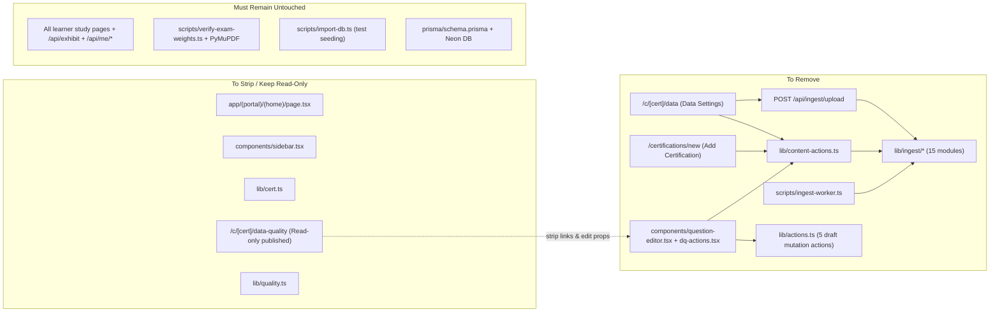

# Removal of Data Settings and Exam Ingestion

- Status: Completed 2026-11-24
- Owner / last updated: implementation agent, 2026-11-24
- Scope decisions confirmed with user:
  - **Exam Coverage & Quality (`/c/[cert]/data-quality`):** Keep as a **read-only** admin dashboard for published versions across all tabs; strip draft mode (`?version=`), draft-editing UI/actions, and Data Settings links.
  - **Database schema (`IngestionJob`, `UploadedFile`):** **No schema changes or migrations.** Leave tables and existing records untouched in SQLite and PostgreSQL; remove only application code that uses them.
  - **Offline CLI scripts & PyMuPDF:** Remove in-app ingestion only. Keep `scripts/import-db.ts` (required by test seeding) and PyMuPDF (`requirements.txt` + PDF extraction helper) for `scripts/verify-exam-weights.ts`.

## Objective

Temporarily remove the entire **Data Settings** UI, **Add Certification** workflow, **in-app exam ingestion pipeline** (PDF upload, website URL scraping, headless browser rendering, OCR, manual JSON upload, background job worker), and **draft/review/publish editing workflows** ahead of the portal demo.

All learner-facing study functionality, published PMLE 2026 content (including `"Exam guide effective June 1, 2026"`), learner progress, version history, and read-only admin **Exam Coverage & Quality** remain intact with zero database migrations and full reversibility.

## Existing Behavior

Reference: [../CURRENT_STATE.md](../CURRENT_STATE.md) (sections 4, 5, 7, 8, 9, 10, 11, 13, 15, 16) and [../INGESTION.md](../INGESTION.md).

---

## 1. Complete Inventory of Components to Remove

### Files and Directories to Delete Completely

- **Frontend pages (2 files):**
  - `app/(portal)/c/[cert]/data/page.tsx` — Data Settings page (versions, sources, jobs, readiness, review/publish, audit log).
  - `app/(portal)/(home)/certifications/new/page.tsx` — Add Certification page (creates empty draft, redirects to Data Settings).
- **Frontend client components (4 files):**
  - `components/data-settings.tsx` — `CertMetaForm`, `NewDraftForm`, `PdfSourceForm`, `UrlSourceForm`, `StartProcessingButton`, `SourceActions`, `VersionActions`, `JobsAutoRefresh`.
  - `components/new-certification-form.tsx` — `NewCertificationForm`.
  - `components/question-editor.tsx` — `QuestionEditor`, `ExcludeToggle` (draft-only inline editor).
  - `components/dq-actions.tsx` — `DuplicateButtons`, `AnswerResolver`, `IssueButtons`, `ClassificationPicker` (draft-only review mutations).
- **API route handler (1 file):**
  - `app/api/ingest/upload/route.ts` — `POST /api/ingest/upload` (PDF/JSON multipart upload into draft).
- **Server actions & backend business logic (17 files):**
  - `lib/content-actions.ts` — all 13 admin content/ingestion/draft/publish actions (`createCertificationAction`, `updateCertificationAction`, `createDraftAction`, `submitForReviewAction`, `returnToDraftAction`, `publishVersionAction`, `deleteDraftAction`, `submitUrlAction`, `startProcessingAction`, `retryJobAction`, `cancelJobAction`, `removeSourceAction`, `editQuestionAction`).
  - `lib/question-edit.ts` — `editQuestion` write logic (move the tiny 5-line read-only `manualEditOf` / `isManuallyEdited` JSON helpers into `lib/quality.ts`).
  - `lib/ingest/` (entire directory, 15 files):
    - `lib/ingest/classify.ts`
    - `lib/ingest/dedupe.ts`
    - `lib/ingest/fetcher.ts`
    - `lib/ingest/html.ts`
    - `lib/ingest/jobs.ts`
    - `lib/ingest/kick.ts`
    - `lib/ingest/normalize.ts`
    - `lib/ingest/ocr.ts`
    - `lib/ingest/pdf.ts`
    - `lib/ingest/pipeline.ts`
    - `lib/ingest/renderer.ts`
    - `lib/ingest/robots.ts`
    - `lib/ingest/text-parser.ts`
    - `lib/ingest/types.ts`
    - `lib/ingest/url-safety.ts`
    - `lib/ingest/validate.ts`
    - `lib/ingest/worker.ts`
    *(Verify exact file count in `lib/ingest/` = 17 files; delete the whole `lib/ingest/` directory.)*
- **Worker script (1 file):**
  - `scripts/ingest-worker.ts` — CLI polling worker (`npm run ingest:worker`).
- **Ingestion-only tests & fixtures (4 files):**
  - `tests/ingest-fixtures.ts`
  - `tests/unit/ingest.test.ts`
  - `tests/unit/ingest-adapters.test.ts`
  - `tests/integration/certifications.test.ts` (tests draft creation, ingestion jobs, URL/PDF/JSON intake, editing, review/publish).

---

## 2. Frontend Removal Plan

| File | Exact Changes |
|---|---|
| `app/(portal)/c/[cert]/data/page.tsx` | Delete file. |
| `app/(portal)/(home)/certifications/new/page.tsx` | Delete file. |
| `components/data-settings.tsx` | Delete file. |
| `components/new-certification-form.tsx` | Delete file. |
| `components/question-editor.tsx` | Delete file. |
| `components/dq-actions.tsx` | Delete file. |
| `components/sidebar.tsx` | In `certGroups()`, remove `{ href: \`${base}/data\`, label: "Data Settings", icon: SlidersHorizontal }` and unused `SlidersHorizontal` import. Keep `Exam Coverage & Quality` under `Content` when `showData && published`. |
| `app/(portal)/(home)/page.tsx` | Remove the `actions` prop on `PageHeader` (`add-certification` / `add-certification-locked` buttons), remove the `Data settings` link (`data-${c.slug}`) and draft badges (`c.drafts`) on `CertCard`, remove unused `Plus` and `Settings2` imports, and update the single-cert `EmptyState` description so it does not instruct admins to "Add a certification". |
| `app/(portal)/c/[cert]/data-quality/page.tsx` | Keep all 8 tabs **read-only** for the **published version only**: (1) remove imports of `dq-actions`, `question-editor`, `question-edit` (use `manualEditOf` from `lib/quality.ts`), `isEditableStatus`; (2) ignore `searchParams.version` completely, never fall back to `draft`/`review` versions, and call `notFound()` whenever `!published`; (3) call `loadPublishedQuality(prisma, published.id)` instead of `loadDraftQuality`; (4) remove `canEdit`, `dataHref`, `vq`, and all `<Link href={L("/data")}>Data Settings</Link>` links (in the read-only banner, `SourcesTable` header action, and `Imports` description); (5) remove all `ctx.canEdit` conditional editor renders (`QuestionEditor`, `ExcludeToggle`, `DuplicateButtons`, `AnswerResolver`, `IssueButtons`, `ClassificationPicker`) and draft banners (`dq-elevate`, `dq-draft`). |

---

## 3. Backend and API Removal Plan

| File | Exact Changes |
|---|---|
| `app/api/ingest/upload/route.ts` | Delete file (and empty `app/api/ingest/` directory). |
| `lib/content-actions.ts` | Delete file. |
| `lib/ingest/*` | Delete entire directory. |
| `lib/question-edit.ts` | Delete file after moving read-only `manualEditOf` and `isManuallyEdited` (reading `rawJson`) into `lib/quality.ts`. |
| `lib/actions.ts` | Remove the 5 draft-only admin mutation server actions (`decideDuplicate`, `resolveAnswer`, `setIssueStatus`, `setManualClassification`, `setOccurrenceExcluded`) and any imports that become unused (`rebuildCanonicals`, `refreshReviewQueue`, `assertEditable`, `audit`, `VersionError`, `requireAdmin` if unused). Keep all learner autosave and session actions untouched. |
| `lib/cert.ts` | In `certPage()`, remove `if (ctx.user.isAdmin) redirect(\`${ctx.base}/data\`);` and call `notFound()` when `!ctx.version` (since Data Settings no longer exists). In `loadHomeCards()`, stop querying/returning `drafts` (or return `[]`) and restrict home cards to published active certifications so unpublished certs (e.g., PDE) do not render dead cards. |
| `lib/quality.ts` | Replace `loadDraftQuality()` / `DraftQuality` with a published-version-specific **`loadPublishedQuality(db, versionId)`** / **`PublishedQuality`** (only 2 remaining callers: `app/(portal)/c/[cert]/data-quality/page.tsx` and `tests/integration/coverage.test.ts`). Inside `loadPublishedQuality()`, verify that the target `ContentVersion` has `status === "published"` (throw an error / refuse to load draft, review, or archived data) so no draft or unpublished data can ever be exposed. Remove `lifecycle()`, `StepState`, `LifecycleStep`, `JobInfo`, `jobInfo()`, `stateOf()`, `checkReadiness` import from `./versions`, and the `db.ingestionJob.findMany(...)` query. Keep computing `inventory`, `sources` (from `questionSource` + `sourceOccurrence`), `questions`, `extracted`, `duplicates`, `issues`, and `exhibits` for the read-only `Exam Coverage & Quality` page. Inline the read-only `manualEditOf` / `isManuallyEdited` helpers. |
| `scripts/ingest-worker.ts` | Delete file. |
| `scripts/ingest/pdf_extract.py` | **Keep** (or move to `scripts/pdf_extract.py` and update `scripts/verify-exam-weights.ts` path reference) because `scripts/verify-exam-weights.ts` uses it with PyMuPDF to verify official exam guide weights. Keeping its path or moving it to `scripts/pdf_extract.py` avoids leaving an `ingest/` folder behind. |

---

## 4. Dependency, Script, and Configuration Cleanup

### `package.json`

- **Scripts to remove:**
  - `"ingest:worker": "tsx scripts/ingest-worker.ts"`
- **Scripts to keep:**
  - `"setup"`, `"ingest:python"`, `"ingest:db"`, `"ingest"` — offline PMLE bootstrap CLI (`scripts/import-db.ts` is also used by tests). *(Optional: `ingest:python`, `ingest:db`, `ingest` can remain as offline bootstrap helpers; `"setup"` must stay.)*
  - All `dev`, `build`, `start`, `lint`, `typecheck`, `test`, `test:e2e`, `postinstall`, `db:*`, `claim-local-progress`, `backup` scripts remain untouched.
- **npm dependencies:**
  - **No runtime `dependencies` can be safely removed** — `zod`, `lucide-react`, `recharts`, `clsx`, `tailwind-merge`, `@prisma/client`, `next`, `react`, `react-dom`, `server-only` are all used by active learner/admin features. (`@neon/config` and `@neon/env` are unrelated CLI scaffolding; do not touch them in this task.)
  - **No `devDependencies` can be safely removed** — `@playwright/test` is still required for `npm run test:e2e` (`tests/e2e/app.spec.ts`).

### Python Dependencies (`requirements.txt`)

- **Keep `requirements.txt` unchanged** (`pymupdf==1.28.2` is required by `scripts/verify-exam-weights.ts` -> `pdf_extract.py`; the other packages support the offline `scripts/pipeline.py` bootstrap script).

### Configuration Files

- **`next.config.ts`:**
  - Remove `"playwright"` and `"playwright-core"` from `serverExternalPackages` (keep `["@prisma/client"]`). They were only bundled for `lib/ingest/renderer.ts`.
  - **Keep** `experimental.proxyClientMaxBodySize: "26mb"` — it is still required by `POST /api/me/restore` (which accepts personal backups up to 25 MB). Update the inline comment above it to reference `/api/me/restore` instead of PDF uploads.
  - Keep all existing redirects intact.
- **`.env.example`:**
  - Remove `INGEST_TESSERACT`, `INGEST_BROWSER`, `INGEST_INLINE`, and `INGEST_ALLOW_PRIVATE_HOSTS` (if present).
  - Keep `INGEST_PYTHON` (used by `scripts/verify-exam-weights.ts`) with an updated comment noting it is used by the exam-guide weight verifier, and update the `ADMIN_EMAILS` comment to drop "certifications, versions, ingestion, data-quality edits" in favour of "Exam Coverage & Quality, server backups".
- **`playwright.config.ts`:**
  - Remove `INGEST_BROWSER: "off"` from `webServer.env`.

---

## 5. Database Cleanup Assessment (Read-Only Analysis; Zero Migrations Planned)

Per the confirmed decision (**no schema changes or migrations**), `prisma/schema.prisma`, `prisma/postgres/schema.prisma`, `prisma/migrations/`, `prisma/postgres/migrations/`, and all production Neon / local SQLite records remain **completely untouched**.

Below is the explicit classification of every relevant database object so future cleanup or rebuilding has a clear map:

### A. Ingestion-Specific Database Objects (Safe to leave idle now; candidates for future drop only if ingestion is permanently retired)

| Object | Risk if dropped later | Dependencies & Impact | Recommendation now |
|---|---|---|---|
| `IngestionJob` table (and `Certification.jobs`, `ContentVersion.ingestionJobs`, `UploadedFile.jobs` relations) | **Low** (no learner or study code reads it once `lib/quality.ts` stops querying it) | Dropping requires coordinated hand-written migrations in both `prisma/migrations/` (SQLite) and `prisma/postgres/migrations/` (PostgreSQL). | **Keep in schema & DB.** Zero runtime cost when unused; preserves full audit/job history and instant rollback. |
| `UploadedFile` table (and `Certification.files`, `QuestionSource.fileId` / `file` FK) | **Medium** | `app/api/pdf/route.ts` still joins `source.file` (`UploadedFile.data`) as primary PDF storage before falling back to `data/raw/pdf/`. Dropping requires altering `QuestionSource` and updating `/api/pdf`. | **Keep in schema & DB.** |

### B. Shared Database Objects That MUST Remain Untouched

| Object | Why it must remain |
|---|---|
| `Certification`, `ContentVersion` (including `guideTitle`, `status`, `publishedAt`, `label`, `questionCount`, `objectiveCount`) | Core multi-version study model; powers `"Exam guide effective June 1, 2026"`, Version History, and learner scoping. |
| `ExamDomain`, `ExamObjective`, `QuestionObjectiveMapping`, `TheoryConcept`, `QuestionTopic` | Exam Blueprint, Blueprint Distribution Alignment, Study Plan, Theory Checklist, Analytics, Mock allocation. |
| `QuestionSource`, `SourceOccurrence`, `CanonicalQuestion`, `AnswerOption`, `AnswerClaim`, `Explanation` | Active question bank, grading, verification status, exhibits (`/api/exhibit`), admin provenance (`/api/pdf`, Exam Coverage & Quality). |
| `DuplicateCandidate`, `ImportRun`, `ImportIssue` | Read by the read-only admin **Exam Coverage & Quality** page (`lib/quality.ts`, `lib/inventory.ts`, `data-quality/page.tsx`) and sidebar issue badge (`layout.tsx`). |
| `AuditEvent` | Used by admin elevation lockouts (`lib/admin-actions.ts`, `lib/auth.ts`). |
| `User`, `AuthSession`, `TheoryProgress`, `QuestionAttempt`, `QuestionFlag`, `QuestionNote`, `PracticeSession`, `SessionQuestion`, `StudyTaskCompletion`, `Setting` | All learner authentication, settings, and progress/history data. |

### C. Existing Ingestion-Specific Records (Potential Future Cleanup Only)

- **Production Neon `IngestionJob` / `UploadedFile` rows** (if any exist) and **unpublished `Certification` rows** (such as `PDE`, which has no published version): **Do not delete.** Leaving them untouched guarantees zero risk to production data; unpublished certifications are simply not surfaced once `loadHomeCards()` filters to published active certifications.
- If a future decision permanently retires ingestion, cleanup would be: (1) snapshot DB, (2) verify zero `QuestionSource.fileId` references in published versions, (3) run a non-destructive row count check, (4) apply paired SQLite + PostgreSQL migrations dropping `IngestionJob` and `UploadedFile`.

---

## 6. Components and Data That Must Be Preserved

- **All learner study routes & components:** `/`, `/settings`, `/c/[cert]` (Dashboard), `/plan`, `/practice`, `/practice/[id]`, `/mock`, `/mock/[id]`, `/questions`, `/questions/[code]`, `/review`, `/flagged`, `/incorrect`, `/bookmarks`, `/theory`, `/theory/[id]`, `/blueprint`, `/analytics`, `/history`.
- **Exam guide effective-date display (`"Exam guide effective June 1, 2026"`):**
  - Stored in `ContentVersion.guideTitle` (`ver_pmle_2026`).
  - Rendered on Dashboard (`app/(portal)/c/[cert]/page.tsx:51`), Exam Blueprint (`app/(portal)/c/[cert]/blueprint/page.tsx:31`), and Exam Coverage & Quality (`app/(portal)/c/[cert]/data-quality/page.tsx:141,151`). None of these are modified.
- **PDF viewing, question exhibits, and source references (verified independent of ingestion):**
  - `app/api/pdf/route.ts` (`/api/pdf`, admin-only): imports only `lib/api.ts`, `lib/cert-rules.ts`, `lib/db.ts`, and reads `QuestionSource` + `UploadedFile` (with fallback to `data/raw/pdf/`). Preserved unchanged; has zero dependency on `lib/ingest/*` or any removed module.
  - `app/api/exhibit/route.ts` (`/api/exhibit`, signed-in) and `lib/exhibits.ts`: import only `lib/api.ts`, `lib/cert-rules.ts`, `lib/db.ts`, `lib/json.ts`, and stream from `public/question-assets/` via `CanonicalQuestion` + `SourceOccurrence`. Preserved unchanged; zero dependency on ingestion.
  - Source abstraction & references: `lib/question-data.ts`, `lib/cert-rules.ts` (`neutralSourceLabels`, `neutralSourceRef`, `sourceShort`), `lib/progress-io.ts` (backup v4 neutral references), `app/api/export/questions/route.ts`, `app/api/me/backup/route.ts`, `app/api/me/restore/route.ts`, `app/api/export/progress/route.ts`, `app/api/health/route.ts`. All preserved unchanged with zero dependency on ingestion.
- **Admin read-only & operational features:**
  - `/c/[cert]/data-quality` (Exam Coverage & Quality, all 8 tabs read-only for published versions only, via `loadPublishedQuality()`, including `DistributionCard` / Blueprint Distribution Alignment and `BlueprintShare`).
  - `AdminAccessCard` in `/settings`, `lib/admin-actions.ts`, `/api/backup`, `/api/admin/db-snapshot`, `lib/backup*.ts` (server DB snapshots still require admin elevation).
- **Offline CLI & test-seeding infrastructure:**
  - `scripts/verify-exam-weights.ts` + `scripts/pdf_extract.py` (or `scripts/ingest/pdf_extract.py`) + `requirements.txt` (PyMuPDF).
  - `scripts/import-db.ts` (and the shared modules it calls: `lib/canonicalize.ts`, `lib/versions.ts`, `lib/review-queue.ts`, `lib/fingerprint.ts`, `lib/bulk.ts`, `lib/similarity.ts`).
  - `scripts/copy-sqlite-to-postgres.ts`, `scripts/db.mjs`, `scripts/backup-db.ts`, `scripts/claim-local-progress.ts`.

---

## 7. Required Tests and Regression Checks

### Tests to Delete

- `tests/ingest-fixtures.ts`
- `tests/unit/ingest.test.ts`
- `tests/unit/ingest-adapters.test.ts`
- `tests/integration/certifications.test.ts`

### Tests to Update

- **`tests/unit/bulk-quality.test.ts`:** Remove the `describeStart` import from `@/lib/ingest/jobs`, the `lifecycle` import from `@/lib/quality`, and their test cases; keep all `lib/bulk` and `isValidOccurrence` tests.
- **`tests/integration/coverage.test.ts`:** Update from `loadDraftQuality` to `loadPublishedQuality` (using `status: "published"` fixtures) and add a test confirming that calling `loadPublishedQuality` on a `draft` or `review` version is rejected.
- **`tests/integration/app-data.test.ts`:** Remove test blocks calling `decideDuplicate` and `resolveAnswer` (lines ~164–200); keep all learner/study/progress integration tests.
- **`tests/integration/multi-user.test.ts`:** Remove assertions calling `decideDuplicate` and `resolveAnswer` (lines ~141–142); keep multi-user isolation and auth boundary tests.
- **`tests/e2e/app.spec.ts`:**
  - Remove the admin end-to-end fixture ingestion/create-certification/draft-edit/publish test block (lines ~605–706).
  - Add/retain explicit assertions that:
    - `/c/pmle/data` and `/certifications/new` return `404` for **both** learners and admins.
    - Sidebar has no "Data Settings" link for admins; Home has no "Add certification" or "Data settings" links.
    - Admin `/c/pmle/data-quality` returns `200`, shows Blueprint Distribution Alignment, Domain coverage, Question quality, Sources table, and all tabs in read-only mode with zero edit buttons or Data Settings links.
    - Learner Dashboard and Exam Blueprint still display `"Exam guide effective June 1, 2026"`.
    - Learner source abstraction, practice, mock, flags, notes, bookmarks, backups, and version history all pass unchanged.

### Validation Commands (Local SQLite & PGlite only — NEVER against Neon)

1. `npx tsc --noEmit`
2. `npx eslint .`
3. `DATABASE_URL="file:$PWD/data/test-base.db" npm test` (SQLite Vitest suite)
4. PostgreSQL Vitest suite against local PGlite (`--max-connections=4`, `--no-file-parallelism`)
5. `DATABASE_URL="file:$PWD/data/test-base.db" npm run build` (then restore SQLite client if needed)
6. `npm run test:e2e` (Playwright e2e suite)
7. `node --import tsx scripts/verify-exam-weights.ts --cert pmle` (local SQLite smoke check that PyMuPDF + verifier script still works)

---

## 8. Implementation Sequence

1. **Step 1 — Move/preserve PDF extraction helper for weight verifier:**
   - Either keep `scripts/ingest/pdf_extract.py` as-is or move it to `scripts/pdf_extract.py` and update `scripts/verify-exam-weights.ts` + `tests/unit/verify-script.test.ts` (if it references the path).
2. **Step 2 — Remove ingestion backend, API route, worker, and content actions:**
   - Delete `app/api/ingest/upload/route.ts`, `lib/ingest/*`, `lib/content-actions.ts`, `scripts/ingest-worker.ts`.
   - Replace `loadDraftQuality()` / `DraftQuality` with `loadPublishedQuality()` / `PublishedQuality` (enforcing `status === "published"`), inline `manualEditOf` / `isManuallyEdited` into `lib/quality.ts`, strip `lifecycle` / `checkReadiness` / `ingestionJob` from `lib/quality.ts`, and delete `lib/question-edit.ts`.
   - Remove the 5 draft-mutation actions from `lib/actions.ts`.
   - Update `lib/cert.ts` (`certPage` -> `notFound()`, `loadHomeCards` -> published active certs only).
3. **Step 3 — Remove Data Settings & Add Certification frontend, make Exam Coverage & Quality read-only:**
   - Delete `app/(portal)/c/[cert]/data/page.tsx`, `app/(portal)/(home)/certifications/new/page.tsx`, `components/data-settings.tsx`, `components/new-certification-form.tsx`, `components/question-editor.tsx`, `components/dq-actions.tsx`.
   - Update `components/sidebar.tsx`, `app/(portal)/(home)/page.tsx`, and `app/(portal)/c/[cert]/data-quality/page.tsx`.
4. **Step 4 — Clean up config and package scripts:**
   - Update `package.json`, `next.config.ts`, `.env.example`, `playwright.config.ts`.
5. **Step 5 — Update and run tests, typecheck, lint, build:**
   - Delete the 4 ingestion test files, update `bulk-quality.test.ts`, `app-data.test.ts`, `multi-user.test.ts`, and `tests/e2e/app.spec.ts`.
   - Run all validation commands from section 7.
6. **Step 6 — Update documentation:**
   - Update `docs/CURRENT_STATE.md`, `docs/DEVELOPMENT_LOG.md`, `docs/architecture/SYSTEM_ARCHITECTURE.md`, `docs/implementation-plans/README.md`, `README.md`, and mark `docs/INGESTION.md` as archived/inactive (or note removal). Update this plan's status to Completed.

---

## 9. Rollback Considerations

- **Trivial full rollback via git:** Because no database migrations, no schema changes, and no destructive data edits are performed, restoring Data Settings and exam ingestion is a single `git revert` of the removal commit(s), followed by `npm run build`.
- **No data loss:** Existing `ContentVersion`, `IngestionJob`, `UploadedFile`, and `Certification` rows in Neon and local SQLite remain intact, so reverting immediately restores prior state without backfills.
- **Rebuilding in the future:** All shared domain models (`Certification`, `ContentVersion`, `QuestionSource`, `SourceOccurrence`, `CanonicalQuestion`, `ExamDomain`, `ExamObjective`) and offline canonicalization modules (`lib/canonicalize.ts`, `lib/versions.ts`) remain in place as a clean foundation for any future ingestion rewrite.

---

## 10. Uncertainties / Shared Dependencies to Double-Check During Implementation

1. **`lib/versions.ts` / `lib/canonicalize.ts` / `lib/review-queue.ts`:** Still imported by `scripts/import-db.ts` (used by `tests/e2e/prepare-db.ts` and integration tests). Do **not** delete them during this removal; verify with `tsc --noEmit` that no dead imports remain.
2. **`tests/unit/verify-script.test.ts`:** Check whether any assertion references `scripts/ingest/pdf_extract.py` if that file is moved to `scripts/pdf_extract.py`.
3. **`data/pmle.db` and Neon `PDE` record:** Confirm on the home page that an admin signing in sees PMLE cleanly without a broken card for unpublished `PDE`.

---

## 11. Final Verification Checklist

- [x] No references to `lib/ingest`, `lib/content-actions`, `components/data-settings`, `components/new-certification-form`, `components/question-editor`, `components/dq-actions`, `/api/ingest/upload`, or `/c/[cert]/data` remain in `app/`, `components/`, `lib/`, `scripts/`, or `tests/`.
- [x] `GET /c/pmle/data`, `GET /certifications/new`, and `POST /api/ingest/upload` return `404` for both learners and admins.
- [x] Sidebar shows no "Data Settings" item; Certification Home shows no "Add certification" or "Data settings" links.
- [x] Admin `GET /c/pmle/data-quality` returns `200`, displays Blueprint Distribution Alignment, Domain coverage, Question quality, Sources table, and all tabs read-only for the published version only, with no edit controls or Data Settings links; passing `?version=<draftId>` does not expose draft data, and `loadPublishedQuality()` rejects non-published versions.
- [x] Existing PDF viewing (`/api/pdf` for admins, 404 for learners), question exhibits (`/api/exhibit`), and source references (neutral labels for learners, provenance for admins) continue to work with zero regressions.
- [x] Learner pages display `"Exam guide effective June 1, 2026"` on Dashboard and Exam Blueprint; learner source abstraction remains intact (no source leaks, `/c/pmle/data-quality` returns `404`).
- [x] All learner workflows work: Dashboard, Study Plan, Practice, Mock Exam, Questions & Review (All/Review/Flagged/Incorrect/Bookmarks), Theory Checklist, Exam Blueprint, Analytics, Version History, Settings, Personal Backup/Restore.
- [x] `scripts/verify-exam-weights.ts` still executes cleanly with PyMuPDF.
- [x] Zero Prisma schema changes, zero migrations created or executed, zero production Neon writes.
- [x] `npx tsc --noEmit`, `npx eslint .`, `npm test` (SQLite + PGlite), `npm run build`, and `npm run test:e2e` all pass.

## 12. Deviations and implementation notes (2026-11-24)

- `lib/ingest/` held 17 files, not 15; the whole directory was deleted.
- The checklist's "no references" item is satisfied apart from the two e2e assertions that deliberately POST to `/api/ingest/upload` and expect 404.
- A POST with a multipart body to a removed path makes Next.js answer 400 (it treats multipart POSTs as malformed Server Actions), so the e2e checks use a JSON POST to prove the route is gone.
- `SourceRow` lost `state`, `job`, `history` and `fileSize` (they only described ingestion jobs), so the Exam Coverage & Quality **Sources** table no longer has a Status column. All other columns are unchanged.
- The Answer conflicts tab now shows an existing reviewer answer read-only instead of the resolver widget; the Duplicates filter "Your decisions" was renamed "Reviewer decisions"; explanatory copy that referred to drafts, editing or Data Settings was reworded.
- `loadHomeCards` returns only active certifications with a published version for administrators too (previously admins also saw drafts and unpublished certifications).
- `tests/integration/multi-user.test.ts`: the "restricts shared question-bank changes to administrators" test became "recognises administrators by email only", because the actions it exercised no longer exist.
- `tests/e2e/prepare-db.ts` now seeds an unpublished draft (`tests/e2e/fixtures.ts`) into the **test** database so e2e can prove `?version=<draftId>` exposes nothing.
- The e2e admin ingestion/publish test was replaced by tests for the removed routes, the read-only/published-only coverage page and the Settings admin-code flow.
- `docs/DEPLOYMENT.md` was also corrected where it described the removed admin workflows (not listed in Step 6).
- A stale generated file, `.next/dev/types/validator.ts` (gitignored, written by the dev server), still referenced the deleted routes and failed `next build`'s type check; it was deleted and is regenerated by Next.js.
- Validation, all local (SQLite and PGlite; no Neon access): `tsc --noEmit` clean; `eslint .` clean; `next build` succeeded; Vitest on SQLite 148 passed; Vitest on PostgreSQL via PGlite 145 passed, 3 skipped (the same PostgreSQL-only skips as before); Playwright e2e 25 passed; `verify-exam-weights.ts --cert pmle` against local SQLite: PASS.
